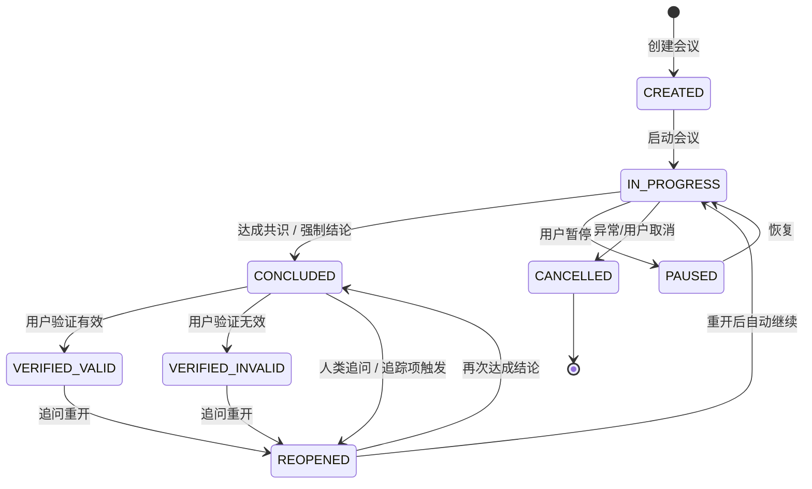
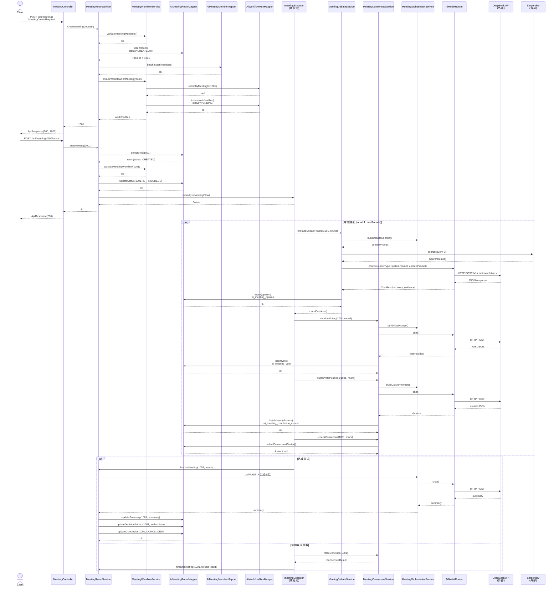
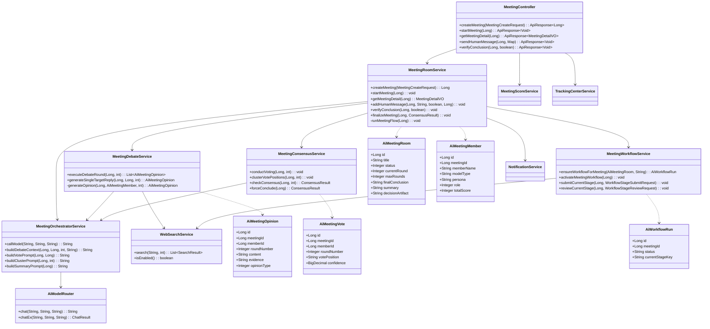
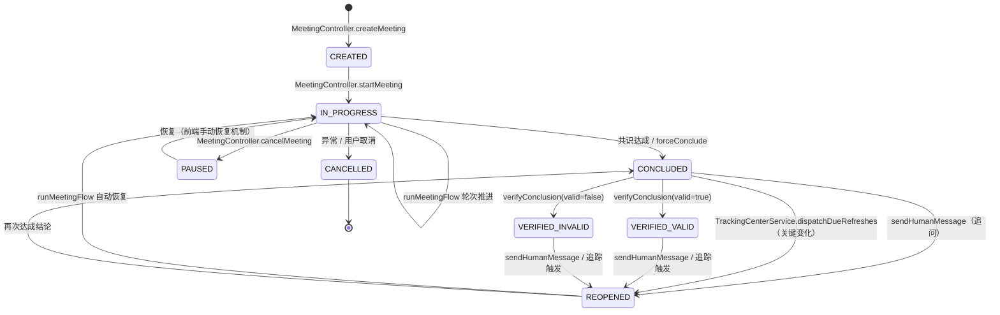
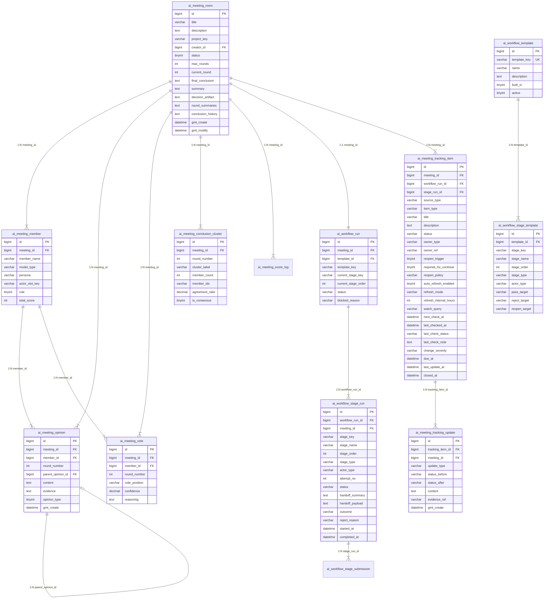

# AI 多成员会议室 — 项目全面分析报告

> 生成时间：2026-05-25
> 分析版本：v1.4.0
> 项目路径：`/Users/wangzilong/IdeaProjects/ai-meeting-room-new`

---

## 一、项目整体总结

### 1. 项目概览

| 维度 | 内容 |
|------|------|
| **一句话业务简介** | AI 多成员会议室系统，通过让多个不同 AI 模型（议员）围绕同一议题进行多轮辩论、投票、共识检查，利用多模型协作减少单一模型的认知偏差，最终输出结构化结论与决策卡片。支持人类用户介入追问、工作流编排、结论追踪与重开。 |
| **Spring Boot 版本** | 2.7.18 |
| **JDK 版本** | 11 |
| **数据库** | MySQL 8.x（生产）/ H2（本地开发，runtime 依赖） |
| **ORM 框架** | MyBatis 2.3.1 |
| **HTTP 客户端** | OkHttp 4.12.0 |
| **JSON 处理** | Fastjson 1.2.83 |
| **工具库** | Hutool 5.8.20 |
| **安全** | Spring Security Crypto（BCrypt 密码加密） |
| **构建工具** | Maven |
| **前端** | Vue 3 + Vite（独立目录 `frontend/`） |

### 2. 核心业务模型

#### 核心实体类（Entity）

| 实体名 | 说明 |
|--------|------|
| `AiMeetingRoom` | 会议主表，聚合根 |
| `AiMeetingMember` | 会议成员（AI 议员），归属于某次会议 |
| `AiMeetingOpinion` | 发言/意见记录，归属于会议和成员 |
| `AiMeetingVote` | 投票记录，每轮每位成员投一票 |
| `AiMeetingConclusionCluster` | 结论聚类，每轮投票后按语义聚类 |
| `AiMeetingScoreLog` | 积分变动日志 |
| `AiWorkflowTemplate` | 工作流模板定义 |
| `AiWorkflowStageTemplate` | 工作流阶段模板定义 |
| `AiWorkflowRun` | 工作流运行实例 |
| `AiWorkflowStageRun` | 工作流阶段运行实例 |
| `AiWorkflowStageSubmission` | 阶段提交与审核记录 |
| `AiMeetingTrackingItem` | 追踪项（待办/监控项） |
| `AiMeetingTrackingUpdate` | 追踪项更新记录 |
| `AiSkillFile` | Skill 文件库 |
| `AiUser` | 系统用户 |

#### 主要数据表关系

- **会议 1:N 成员**：一次会议配置多个 AI 议员
- **会议 1:N 发言**：一次会议由多名成员进行多轮发言
- **会议 1:N 投票**：每轮每位成员产生一条投票记录
- **会议 1:N 结论聚类**：每轮投票后生成语义聚类结果
- **会议 1:1 工作流运行**：一次会议绑定一个工作流运行实例
- **工作流运行 1:N 阶段运行**：一个工作流实例包含多个阶段运行
- **阶段运行 1:N 提交记录**：每个阶段可有多条提交/审核记录
- **会议/阶段 1:N 追踪项**：会议或阶段可产生多个追踪项
- **追踪项 1:N 更新记录**：一个追踪项可有多条更新历史
- **模板 1:N 阶段模板**：一个工作流模板定义多个阶段模板

### 3. 领域对象与实体描述

#### 主要领域对象

| 领域对象 | 类型 | 关键属性 | 职责 |
|----------|------|----------|------|
| `AiMeetingRoom` | 聚合根 | `status`, `currentRound`, `maxRounds`, `finalConclusion`, `decisionArtifact`, `roundSummaries`, `conclusionHistory` | 管理会议生命周期、结论与历史版本 |
| `AiMeetingMember` | 实体 | `modelType`, `persona`, `role`, `totalScore`, `actorSlotKey` | 代表一个 AI 议员，绑定特定大模型与人设 |
| `AiMeetingOpinion` | 值对象 | `opinionType`, `content`, `evidence`, `parentOpinionId` | 记录一次发言，含结构化论据（JSON） |
| `AiMeetingVote` | 值对象 | `votePosition`, `confidence`, `reasoning` | 记录成员对本轮讨论的立场投票 |
| `AiMeetingConclusionCluster` | 值对象 | `clusterLabel`, `agreementRatio`, `isConsensus`, `memberIds` | 语义聚类结果，判断共识是否达成 |
| `AiWorkflowRun` | 聚合根 | `status`, `currentStageKey`, `blockedReason` | 工作流运行状态机 |
| `AiWorkflowStageRun` | 实体 | `stageType`, `status`, `outcome`, `handoffSummary` | 阶段运行状态与交付物 |
| `AiMeetingTrackingItem` | 实体 | `status`, `watchQuery`, `autoRefreshEnabled`, `reopenPolicy` | 追踪项，可自动刷新并触发会议重开 |

#### 核心状态机

**会议状态（`MeetingStatusEnum`）**



**工作流运行状态（`WorkflowRunStatusEnum`）**

| 状态码 | 含义 |
|--------|------|
| `PENDING` | 待开始 |
| `ACTIVE` | 执行中 |
| `WAITING_TRACKING` | 等待追踪 |
| `CONCLUDED` | 已收敛 |
| `REOPENED` | 已重开 |

**追踪项状态（`TrackingItemStatusEnum`）**

| 状态码 | 含义 |
|--------|------|
| `OPEN` | 待处理 |
| `IN_PROGRESS` | 处理中 |
| `BLOCKED` | 已阻塞 |
| `READY_FOR_REVIEW` | 待复核 |
| `VERIFIED` | 已验证 |
| `REJECTED` | 已驳回 |
| `CLOSED` | 已关闭 |

### 4. 核心业务流程

#### 功能一：会议创建

**调用链**：

```
MeetingController.createMeeting
  └─ MeetingRoomService.createMeeting
       ├─ MeetingWorkflowService.validateMeetingMembers      // 校验成员与工作流模板匹配
       ├─ AiMeetingRoomMapper.insert                         // 插入会议主表
       ├─ AiMeetingMemberMapper.batchInsert                  // 批量插入成员
       └─ MeetingWorkflowService.ensureWorkflowForMeeting    // 确保工作流实例存在
```

**关键数据**：会议初始状态 `status = 0 (CREATED)`，`currentRound = 0`。

#### 功能二：会议启动（异步执行）

**调用链**：

```
MeetingController.startMeeting
  └─ MeetingRoomService.startMeeting
       ├─ AiMeetingRoomMapper.selectById
       ├─ MeetingWorkflowService.ensureWorkflowForMeeting
       ├─ AiMeetingRoomMapper.updateStatus -> IN_PROGRESS
       ├─ MeetingWorkflowService.activateMeetingWorkflow     // 激活工作流
       └─ ExecutorService.submit -> runMeetingFlow            // 提交异步任务
```

**关键数据**：状态由 `CREATED(0)` 变为 `IN_PROGRESS(1)`。

#### 功能三：单轮辩论与发言生成

**调用链**：

```
runMeetingFlow (async)
  └─ MeetingDebateService.executeDebateRound
       ├─ MeetingWorkflowService.resolveMembersForCurrentStage
       ├─ generateOpinionWithRetry -> generateOpinion
       │    ├─ 阶段1：搜索决策（WebSearchService.isEnabled / search）
       │    │    └─ 外部调用：Serper API / 智谱搜索 API / DeepSeek Web Bridge
       │    ├─ 阶段2：调用 AI 模型生成发言
       │    │    └─ MeetingOrchestratorService.callModel / callModelEx
       │    │         └─ AiModelRouter.chat / chatEx
       │    │              └─ GenericAiClient / OpenAiClient / ClaudeClient / WenxinClient
       │    │                   └─ 外部调用：各 AI 模型 HTTP API
       │    └─ AiMeetingOpinionMapper.insert                  // 持久化发言
       └─ 返回本轮所有发言
```

**关键外部依赖**：
- **联网搜索**：`WebSearchService.search(query)` → Serper.dev / 智谱 GLM-4-Flash / DeepSeek Web Bridge
- **AI 模型调用**：`AiModelRouter.chat()` → DeepSeek API / OpenAI API / Claude API / 通义千问 API / 文心一言 API

#### 功能四：投票与共识检查

**调用链**：

```
runMeetingFlow (async)
  ├─ MeetingConsensusService.conductVoting
  │    ├─ 遍历成员：MeetingOrchestratorService.buildVotePrompt
  │    ├─ 调用 AI 模型生成投票 JSON
  │    └─ AiMeetingVoteMapper.insert
  ├─ MeetingConsensusService.clusterVotePositions
  │    ├─ MeetingOrchestratorService.buildClusterPrompt
  │    ├─ 调用 AI 模型进行语义聚类
  │    └─ AiMeetingConclusionClusterMapper.batchInsert
  └─ MeetingConsensusService.checkConsensus
       └─ AiMeetingConclusionClusterMapper.selectConsensusCluster
```

#### 功能五：会议结论生成与归档

**调用链**：

```
MeetingRoomService.finalizeMeeting
  ├─ MeetingOrchestratorService.callModel -> 生成会议总结
  ├─ MeetingOrchestratorService.callModel -> 生成决策卡片 JSON
  ├─ AiMeetingRoomMapper.updateSummary
  ├─ AiMeetingRoomMapper.updateDecisionArtifact
  ├─ AiMeetingRoomMapper.updateConclusionHistory
  ├─ MeetingWorkflowService.markMeetingConcluded
  └─ NotificationService.sendMeetingConclusion -> Server酱微信通知（可选）
```

#### 功能六：人类用户介入

**调用链**：

```
MeetingController.sendHumanMessage
  └─ MeetingRoomService.addHumanMessage
       ├─ 状态判断：若已结束则触发 reopenMeetingForFollowUp
       │    ├─ 插入人类追问意见（AiMeetingOpinionMapper.insert）
       │    ├─ 更新会议状态为 REOPENED
       │    ├─ MeetingWorkflowService.reopenMeetingWorkflow
       │    └─ ExecutorService.submit -> runMeetingFlow
       └─ 若进行中则直接插入意见
```

#### 功能七：追踪中心自动刷新

**调用链**：

```
TrackingCenterService.dispatchDueRefreshes (@Scheduled)
  └─ TrackingCenterService.processDueRefreshBatch
       └─ TrackingCenterService.refreshItemInternal
            ├─ WebSearchService.search -> 外部搜索
            ├─ WebSearchService.buildResearchDigest
            ├─ 计算变化严重度（changeSeverity）
            ├─ AiMeetingTrackingItemMapper.update
            ├─ AiMeetingTrackingUpdateMapper.insert
            └─ 若触发重开条件 → MeetingRoomService.reopenMeetingFromTrackingSignal
```

#### 功能八：工作流阶段提交与审核

**调用链**：

```
MeetingController.submitWorkflowStage
  └─ MeetingRoomService.submitWorkflowStage
       └─ MeetingWorkflowService.submitCurrentStage
            ├─ 根据 stageType 执行：AUTO / HUMAN_SUBMIT / REVIEW
            ├─ AiWorkflowStageRunMapper.update
            ├─ AiWorkflowStageSubmissionMapper.insert
            └─ 推进到下一阶段或阻塞等待审核
```

### 5. 架构分层

```
frontend/                    Vue 3 前端应用
src/main/java/com/aimeeting/room/
├── common/                  通用封装（ApiResponse）
├── config/                  配置类（AI模型、拦截器、Token、数据初始化等）
├── controller/              REST API 控制器层
├── dto/                     数据传输对象
├── entity/                  领域实体/数据模型
├── enums/                   枚举定义
├── dao/                     数据访问层（Mapper 接口）
└── service/                 业务服务层
     ├── ai/                 AI 模型客户端与搜索服务
     ├── MeetingRoomService.java          会议生命周期主服务
     ├── MeetingDebateService.java        辩论/发言生成服务
     ├── MeetingConsensusService.java     投票/共识/聚类服务
     ├── MeetingOrchestratorService.java  AI 编排/提示词构建服务
     ├── MeetingWorkflowService.java      工作流引擎服务
     ├── MeetingScoreService.java         积分计算服务
     ├── TrackingCenterService.java       追踪中心服务
     ├── NotificationService.java         通知服务
     └── SkillFileService.java            Skill 文件管理服务
src/main/resources/
├── mapper/                  MyBatis XML 映射文件
├── sql/                     数据库初始化脚本
└── application.yml          主配置文件
```

**模块间依赖关系**：
- Controller 层依赖 Service 层
- Service 层依赖 DAO 层和外部 AI Client
- `MeetingRoomService` 是核心协调者，依赖几乎所有其他 Service
- `MeetingOrchestratorService` 负责提示词构建，是 AI 调用的统一入口
- `AiModelRouter` 负责按模型类型路由到具体 Client 实现

### 6. 外部依赖与上下游梳理

| 依赖类型 | 名称/组件 | 用途 | 交互模块 | 配置位置 | 影响的关键功能 |
|----------|-----------|------|----------|----------|----------------|
| AI 模型 API | DeepSeek API | 默认对话模型、推理模型，发言生成、投票、总结 | `GenericAiClient`, `MeetingOrchestratorService` | `application.yml : ai.models.deepseek` | 辩论发言、投票、共识聚类、结论生成 |
| AI 模型 API | OpenAI API | 兼容 OpenAI 格式的第三方模型 | `GenericAiClient` | `application.yml : ai.models.openai` | 辩论发言、投票等 |
| AI 模型 API | Claude API | Anthropic Claude 模型 | `ClaudeClient` | `application.yml : ai.models.claude` | 辩论发言等 |
| AI 模型 API | 通义千问 API | 阿里云大模型 | `GenericAiClient` | `application.yml : ai.models.tongyi` | 辩论发言等 |
| AI 模型 API | 文心一言 API | 百度大模型 | `WenxinClient` | `application.yml : ai.models.wenxin` | 辩论发言等 |
| 搜索 API | Serper.dev | Google Search API，获取实时资讯 | `WebSearchService` | `application.yml : ai.search.serper-api-key` | 议员发言前的联网搜索 |
| 搜索 API | 智谱 GLM-4-Flash | 内置联网搜索+摘要 | `WebSearchService` | `application.yml : ai.search.zhipu` | 议员发言前的联网搜索 |
| 搜索桥接 | DeepSeek Web Bridge | 本地 Node.js 桥接 DeepSeek 网页搜索 | `WebSearchService` | `application.yml : ai.search.deepseek-web` | 议员发言前的联网搜索（实验性） |
| 通知服务 | Server酱 | 微信推送会议结论 | `NotificationService` | `application.yml : notification.serverchan-key` | 会议结论达成后通知 |
| 数据库 | MySQL | 业务数据持久化 | 所有 DAO Mapper | `application.yml : spring.datasource` | 所有业务功能 |
| 本地文件系统 | 磁盘 | Skill 文件上传存储 | `SkillFileService` | `uploads/skill-files/` | Skill 文件管理 |

### 7. 特殊规范

#### 统一异常处理机制

项目未使用 `@RestControllerAdvice` 全局异常处理，而是采用**Controller 层逐方法 try-catch** 模式：

```java
try {
    // 业务逻辑
    return ApiResponse.ok(data);
} catch (Exception e) {
    log.error("xxx error", e);
    return ApiResponse.fail(e.getMessage());
}
```

#### 统一返回值封装

- 类名：`ApiResponse<T>`
- 成功：`code = 200`, `msg = "success"`
- 失败：`code = 500` 或自定义，附带错误消息

#### 自定义注解

无显著自定义注解，采用 Spring 标准注解（`@RestController`, `@Service`, `@MapperScan`, `@Scheduled`, `@Validated` 等）。

#### 设计模式

| 模式 | 应用位置 | 说明 |
|------|----------|------|
| **策略模式** | `AiModelClient` 及其实现类 | `GenericAiClient`, `OpenAiClient`, `ClaudeClient`, `WenxinClient` 实现统一接口，由 `AiModelRouter` 按模型类型路由 |
| **模板方法模式** | `MeetingWorkflowService` | 工作流阶段执行有标准化的推进、审核、回退逻辑 |
| **状态模式** | 会议/工作流/追踪项 | 通过枚举状态码控制行为分支 |
| **工厂模式** | `ModelRegistryStore` | 动态注册和管理模型配置 |

---

## 二、针对指定功能的深度分析

**用户指定功能**：AI 会议室创建与启动
**主要入口**：`com.aimeeting.room.controller.MeetingController.createMeeting`
**辅助入口**：`com.aimeeting.room.controller.MeetingController.startMeeting`

### 1. 流程图 (Mermaid)

以下以具体实例 **会议 `MTG20260525001`**（对应数据库记录 `id = 1001`）贯穿全程。

```mermaid
flowchart TD
    A[Client 提交创建请求<br/>POST /api/meetings] --> B[MeetingController.createMeeting]
    B --> C[MeetingRoomService.createMeeting]
    C --> D{校验成员与工作流模板<br/>MeetingWorkflowService.validateMeetingMembers}
    D -->|校验通过| E[构建 AiMeetingRoom 对象<br/>status: 0 CREATED]
    E --> F[AiMeetingRoomMapper.insert<br/>ai_meeting_room 表 INSERT<br/>记录 id=1001, status=0, current_round=0]
    F --> G{请求包含成员列表?}
    G -->|是| H[构建 AiMeetingMember 列表<br/>绑定 modelType / persona]
    H --> I[AiMeetingMemberMapper.batchInsert<br/>ai_meeting_member 表 INSERT<br/>member_id=2001~2004]
    G -->|否| J[跳过成员创建]
    I --> K
    J --> K[MeetingWorkflowService.ensureWorkflowForMeeting]
    K --> L{会议是否已有工作流实例?}
    L -->|否| M[创建工作流运行实例<br/>AiWorkflowRun status=PENDING<br/>ai_workflow_run 表 INSERT]
    L -->|是| N[返回已有实例]
    M --> O[返回 meetingId = 1001]
    N --> O
    O --> P[ApiResponse.ok 1001]

    P --> Q[Client 提交启动请求<br/>POST /api/meetings/1001/start]
    Q --> R[MeetingController.startMeeting]
    R --> S[MeetingRoomService.startMeeting]
    S --> T[AiMeetingRoomMapper.selectById<br/>校验会议存在且状态合法]
    T --> U[MeetingWorkflowService.ensureWorkflowForMeeting]
    U --> V[AiMeetingRoomMapper.updateStatus<br/>status: 0 → 1 IN_PROGRESS]
    V --> W{是否为默认圆桌工作流?}
    W -->|是| X[MeetingWorkflowService.activateMeetingWorkflow]
    W -->|否| Y[activateMeetingWorkflow + 异常回退到 PAUSED]
    X --> Z[ExecutorService.submit<br/>提交异步任务 runMeetingFlow]
    Y --> Z
    Z --> AA[ApiResponse.ok]

    AA --> AB[异步线程: runMeetingFlow]
    AB --> AC[for round = 1 to maxRounds]
    AC --> AD[AiMeetingRoomMapper.updateCurrentRound<br/>current_round = round]
    AD --> AE[MeetingDebateService.executeDebateRound<br/>生成各成员发言]
    AE --> AF[MeetingConsensusService.conductVoting<br/>各成员投票]
    AF --> AG[MeetingConsensusService.clusterVotePositions<br/>语义聚类]
    AG --> AH[生成轮次摘要<br/>updateRoundSummaries]
    AH --> AI[MeetingConsensusService.checkConsensus<br/>检查是否达成共识]
    AI -->|共识达成| AJ[MeetingRoomService.finalizeMeeting<br/>生成结论、总结、决策卡片]
    AI -->|未达成共识| AK[继续下一轮]
    AK --> AC
    AC -->|达到最大轮数| AL[MeetingConsensusService.forceConclude<br/>强制取最大聚类为结论]
    AL --> AJ
    AJ --> AM[MeetingWorkflowService.markMeetingConcluded]
    AM --> AN[NotificationService.sendMeetingConclusion<br/>Server酱微信推送]
    AN --> AO[结束]
```



### 2. 时序图 (Mermaid)



### 3. 系统间依赖图 (Mermaid)

```mermaid
graph TD
    Svc[AI会议室服务] --> DB[MySQL ai_meeting 库]
    Svc --> AI[DeepSeek API 外部 AI 模型]
    Svc --> Search[Serper.dev 联网搜索]
    Svc --> Notify[Server酱 微信通知]
    
    subgraph 创建阶段
        Svc -->|INSERT ai_meeting_room| DB
        Svc -->|INSERT ai_meeting_member| DB
        Svc -->|INSERT ai_workflow_run| DB
    end
    
    subgraph 启动阶段
        Svc -->|UPDATE status=IN_PROGRESS| DB
    end
    
    subgraph 辩论阶段
        Svc -->|search query| Search
        Search -->|SearchResult 数组| Svc
        Svc -->|POST v1 chat completions| AI
        AI -->|content reasoning| Svc
        Svc -->|INSERT ai_meeting_opinion| DB
    end
    
    subgraph 投票阶段
        Svc -->|POST v1 chat completions| AI
        AI -->|vote JSON| Svc
        Svc -->|INSERT ai_meeting_vote| DB
    end
    
    subgraph 聚类阶段
        Svc -->|POST v1 chat completions| AI
        AI -->|cluster JSON| Svc
        Svc -->|INSERT ai_meeting_conclusion_cluster| DB
    end
    
    subgraph 结论阶段
        Svc -->|POST v1 chat completions| AI
        AI -->|summary| Svc
        Svc -->|UPDATE status=CONCLUDED| DB
        Svc -->|微信推送| Notify
    end
```



### 4. 数据状态变化分析

#### 会议状态流转

| 状态码 | 状态名 | 含义 |
|--------|--------|------|
| 0 | CREATED | 已创建，等待启动 |
| 1 | IN_PROGRESS | 进行中，正在辩论 |
| 2 | CONCLUDED | 已达成结论 |
| 3 | VERIFIED_VALID | 结论已验证有效 |
| 4 | VERIFIED_INVALID | 结论已验证无效 |
| 5 | PAUSED | 已暂停 |
| 6 | REOPENED | 结论修订中（重开） |
| 7 | CANCELLED | 已取消 |

**实例 `MTG20260525001`（`id=1001`）的状态变化**：

| 阶段 | 触发条件 | 状态变更 | 业务含义 |
|------|----------|----------|----------|
| 创建完成 | 用户调用 POST /api/meetings | `null` → `CREATED(0)` | 会议配置已保存，等待启动 |
| 启动会议 | 用户调用 POST /api/meetings/1001/start | `CREATED(0)` → `IN_PROGRESS(1)` | 异步辩论流程开始执行 |
| 轮次推进 | 每轮开始时自动更新 | `current_round` 递增 | 记录当前辩论轮次 |
| 达成共识 | 某轮聚类同意比例 ≥ 70% 且 ≥ 2 人 | `IN_PROGRESS(1)` → `CONCLUDED(2)` | 辩论结束，结论已生成 |
| 用户验证 | 用户调用 POST /api/meetings/1001/verify?valid=true | `CONCLUDED(2)` → `VERIFIED_VALID(3)` | 结论被人类认可，触发积分奖励 |
| 用户验证 | 用户调用 POST /api/meetings/1001/verify?valid=false | `CONCLUDED(2)` → `VERIFIED_INVALID(4)` | 结论被人类否定，触发积分惩罚 |
| 人类追问 | 用户调用 POST /api/meetings/1001/human-message | `CONCLUDED(2)` → `REOPENED(6)` | 基于追问内容重新辩论 |
| 追踪触发 | 追踪项检测到关键变化 | `CONCLUDED(2)` → `REOPENED(6)` | 外部信息变化触发重审 |
| 用户暂停 | 用户调用 POST /api/meetings/1001/pause 或 /cancel | `IN_PROGRESS(1)` → `PAUSED(5)` | 暂时中断辩论流程 |
| 异常终止 | 异步流程抛出异常 | `IN_PROGRESS(1)` → `CANCELLED(7)` | 系统异常导致会议终止 |

### 5. UML 类图 (Mermaid)



### 6. 功能入口全景与生命周期影响分析

#### 6.1 所有入口点梳理

| 入口类型 | 类名.方法名 | 触发方式 | 路径/Topic | 业务描述 |
|----------|-------------|----------|------------|----------|
| API | MeetingController.createMeeting | POST | /api/meetings | 用户创建新会议 |
| API | MeetingController.startMeeting | POST | /api/meetings/{id}/start | 用户启动会议，触发异步辩论 |
| API | MeetingController.getMeetingDetail | GET | /api/meetings/{id} | 查询会议详情与进度 |
| API | MeetingController.listMeetings | GET | /api/meetings | 查询会议列表 |
| API | MeetingController.listWorkflowTemplates | GET | /api/workflow-templates | 查询工作流模板列表 |
| API | MeetingController.getWorkflowTemplateDetail | GET | /api/workflow-templates/detail | 查询工作流模板详情 |
| API | MeetingController.createWorkflowTemplate | POST | /api/workflow-templates | 创建工作流模板 |
| API | MeetingController.listSkillFiles | GET | /api/skill-files | 查询 Skill 文件列表 |
| API | MeetingController.uploadSkillFile | POST | /api/skill-files/upload | 上传 Skill 文件 |
| API | MeetingController.downloadSkillFile | GET | /api/skill-files/{id}/download | 下载 Skill 文件 |
| API | MeetingController.sendHumanMessage | POST | /api/meetings/{id}/human-message | 人类用户介入发言/追问 |
| API | MeetingController.verifyConclusion | POST | /api/meetings/{id}/verify | 用户验证结论有效性 |
| API | MeetingController.getContributions | GET | /api/meetings/{id}/contributions | 查询成员贡献度 |
| API | MeetingController.getMemberScores | GET | /api/members/{memberId}/scores | 查询成员积分历史 |
| API | MeetingController.cancelMeeting | POST | /api/meetings/{id}/cancel 或 /api/meetings/{id}/pause | 暂停进行中的会议 |
| API | MeetingController.terminateMeeting | POST | /api/meetings/{id}/terminate | 强制终止并生成结论 |
| API | MeetingController.restartMeeting | POST | /api/meetings/{id}/restart | 清空记录重启会议 |
| API | MeetingController.cloneMeeting | POST | /api/meetings/{id}/clone | 复制会议配置 |
| API | MeetingController.updateTrackingItem | POST | /api/tracking-items/{id}/status | 更新追踪项状态 |
| API | MeetingController.trackingOverview | GET | /api/tracking-items/overview | 追踪中心概览 |
| API | MeetingController.createCustomTrackingItem | POST | /api/tracking-items/custom | 创建自定义追踪项 |
| API | MeetingController.refreshTrackingItem | POST | /api/tracking-items/{id}/refresh | 手动刷新追踪项 |
| API | MeetingController.reopenMeetingFromTracking | POST | /api/tracking-items/{id}/reopen-meeting | 从追踪项触发会议重开 |
| API | MeetingController.submitWorkflowStage | POST | /api/meetings/{id}/workflow/submit | 提交工作流阶段 |
| API | MeetingController.reviewWorkflowStage | POST | /api/meetings/{id}/workflow/review | 审核工作流阶段 |
| API | MeetingController.retryWorkflowAutoStage | POST | /api/meetings/{id}/workflow/retry-auto | 重试自动执行节点 |
| 定时 | TrackingCenterService.dispatchDueRefreshes | @Scheduled | fixedDelay 60s | 定时扫描并刷新追踪项 |
| 内部 | MeetingRoomService.runMeetingFlow | 异步线程 | meetingExecutor 线程池 | 会议核心辩论循环 |

#### 6.2 完整生命周期流程（状态机图）



### 7. 外部依赖接口明细与影响分析

| 外部依赖 | 类型 | 接口 / 方法 | 交互方式 | 传递的关键数据 | 接口角色 | 影响程度 | 备注/降级策略 |
|----------|------|--------------|-----------|----------------|----------|-----------|----------------|
| MySQL（ai_meeting 库） | 数据库 | 各 Mapper.insert/update/select | 同步 SQL | 会议、成员、发言、投票、聚类、工作流、追踪项全量数据 | 业务数据持久化 | 阻断 | 无降级，必须可用 |
| DeepSeek API | 第三方 AI | POST /v1/chat/completions | 同步 HTTP | systemPrompt, userPrompt, model, maxTokens | 默认对话与推理模型 | 阻断 | 自动降级到注册表中其他 enabled 模型 |
| OpenAI API | 第三方 AI | POST /v1/chat/completions | 同步 HTTP | systemPrompt, userPrompt, model | 兼容 OpenAI 格式的模型 | 高 | 通过 AiModelRouter 自动路由到其他客户端 |
| Serper.dev | 第三方搜索 | POST /search | 同步 HTTP | query, apiKey | Google 搜索结果 | 中 | 未配置时返回空列表，按 Provider 顺序降级到智谱/DeepSeek Web Bridge |
| 智谱 GLM-4-Flash | 第三方搜索+摘要 | POST /api/paas/v4/web_search | 同步 HTTP | search_query, apiKey | 联网搜索与结果摘要 | 中 | 未配置 API Key 时跳过，按 Provider 顺序降级到其他搜索 Provider |
| DeepSeek Web Bridge | 本地桥接 | POST http://127.0.0.1:8789/search | 同步 HTTP | query | DeepSeek 网页搜索桥接 | 中 | 需本地启动 Node.js 桥接服务，未启用时跳过 |
| Server酱 | 第三方通知 | POST https://sct.ftqq.com/... | 同步 HTTP | title, desp | 微信推送会议结论 | 低 | 未配置 key 时不发送，不影响主流程 |

---

## 三、数据库表相关分析

### 0. 业务逻辑相关表

| 表名 | 作用 | 操作类型 | 关键字段 |
|------|------|----------|----------|
| ai_meeting_room | 会议主表 | INSERT, UPDATE | id, title, status, current_round, max_rounds, final_conclusion, decision_artifact |
| ai_meeting_member | 会议成员 | INSERT | id, meeting_id, member_name, model_type, persona, role |
| ai_meeting_opinion | 发言记录 | INSERT | id, meeting_id, member_id, round_number, content, evidence, opinion_type |
| ai_meeting_vote | 投票记录 | INSERT | id, meeting_id, member_id, round_number, vote_position, confidence |
| ai_meeting_conclusion_cluster | 结论聚类 | INSERT | id, meeting_id, round_number, cluster_label, agreement_ratio, is_consensus |
| ai_meeting_score_log | 积分日志 | INSERT | id, meeting_id, member_id, score_delta, reason |
| ai_workflow_template | 工作流模板 | SELECT, INSERT, UPDATE, DELETE | id, template_key, name, active |
| ai_workflow_stage_template | 阶段模板 | SELECT, INSERT | id, template_id, stage_key, stage_order, stage_type, pass_target, reject_target |
| ai_workflow_run | 工作流运行 | INSERT, UPDATE | id, meeting_id, template_id, status, current_stage_key |
| ai_workflow_stage_run | 阶段运行 | INSERT, UPDATE | id, workflow_run_id, stage_key, status, outcome |
| ai_workflow_stage_submission | 阶段提交记录 | INSERT | id, stage_run_id, action_type, content |
| ai_meeting_tracking_item | 追踪项 | INSERT, UPDATE | id, meeting_id, status, watch_query, change_severity |
| ai_meeting_tracking_update | 追踪更新记录 | INSERT | id, tracking_item_id, update_type, status_before, status_after |
| ai_skill_file | Skill 文件 | SELECT, INSERT, DELETE | id, file_name, storage_path |
| ai_user | 系统用户 | SELECT, INSERT | id, username, password, nickname |

### 1. 可视化表关联关系（ER 图）



### 2. 核心表字段详细说明

#### ai_meeting_room（会议主表）

| 字段名 | 类型 | 长度 | 必填 | 默认值 | 业务含义 | 备注 |
|--------|------|------|------|--------|----------|------|
| id | bigint | - | 是 | 自增 | 会议唯一标识 | 主键 |
| title | varchar | 256 | 是 | 无 | 会议主题 | |
| description | text | - | 否 | NULL | 会议描述 | |
| project_key | varchar | 128 | 否 | NULL | 项目标识/工作区键 | 用于同项目历史记忆继承 |
| project_context | text | - | 否 | NULL | 项目背景与共享上下文 | |
| inherited_context | text | - | 否 | NULL | 从同项目历史会议继承的上下文 | 创建时自动构建 |
| creator_id | bigint | - | 是 | 无 | 创建者用户ID | 外键，关联 ai_user |
| status | tinyint | - | 是 | 0 | 会议状态 | 0-已创建 1-进行中 2-已达成结论 3-验证有效 4-验证无效 5-已暂停 6-重开中 7-已取消 |
| max_rounds | int | - | 是 | 10 | 最大辩论轮数 | 可配置 |
| current_round | int | - | 是 | 0 | 当前轮次 | 进行中时递增 |
| final_conclusion | text | - | 否 | NULL | 最终结论 | 共识达成后填充 |
| conclusion_time | datetime | - | 否 | NULL | 达成结论时间 | |
| summary | text | - | 否 | NULL | AI生成的会议总结 | 结论时由模型生成 |
| decision_artifact | text | - | 否 | NULL | 结构化决策卡片JSON | 包含 keyViewpoints, majorDisputes, nextActions 等 |
| round_summaries | text | - | 否 | NULL | 每轮摘要JSON数组 | [{"round":1,"summary":"..."}] |
| conclusion_history | text | - | 否 | NULL | 结论版本历史JSON | 记录每次结论/重开事件 |
| gmt_create | datetime | - | 是 | CURRENT_TIMESTAMP | 创建时间 | |
| gmt_modify | datetime | - | 是 | CURRENT_TIMESTAMP ON UPDATE | 更新时间 | |

#### ai_meeting_member（会议成员表）

| 字段名 | 类型 | 长度 | 必填 | 默认值 | 业务含义 | 备注 |
|--------|------|------|------|--------|----------|------|
| id | bigint | - | 是 | 自增 | 成员唯一标识 | 主键 |
| meeting_id | bigint | - | 是 | 无 | 所属会议ID | 外键，关联 ai_meeting_room |
| member_name | varchar | 128 | 是 | 无 | 成员名称 | 如"理性分析者" |
| model_type | varchar | 64 | 是 | 无 | 模型标识 | 如 deepseek-chat, gpt-4 |
| persona | varchar | 1024 | 是 | 无 | 人设/系统提示词 | 定义成员角色立场 |
| actor_slot_key | varchar | 128 | 否 | NULL | 执行槽位标识 | 工作流节点绑定用 |
| actor_slot_name | varchar | 128 | 否 | NULL | 执行槽位名称 | |
| role | tinyint | - | 是 | 0 | 角色 | 0-参与者 1-主持人 |
| total_score | int | - | 是 | 0 | 累计积分 | 验证时奖惩累加 |
| gmt_create | datetime | - | 是 | CURRENT_TIMESTAMP | 创建时间 | |
| gmt_modify | datetime | - | 是 | CURRENT_TIMESTAMP ON UPDATE | 更新时间 | |

#### ai_meeting_opinion（发言记录表）

| 字段名 | 类型 | 长度 | 必填 | 默认值 | 业务含义 | 备注 |
|--------|------|------|------|--------|----------|------|
| id | bigint | - | 是 | 自增 | 发言唯一标识 | 主键 |
| meeting_id | bigint | - | 是 | 无 | 所属会议ID | 外键 |
| member_id | bigint | - | 是 | 无 | 发言成员ID | 0=人类用户 |
| round_number | int | - | 是 | 无 | 所属轮次 | |
| parent_opinion_id | bigint | - | 否 | NULL | 回复的发言ID | NULL=原始发言 |
| content | text | - | 是 | 无 | 发言内容 | |
| evidence | text | - | 否 | NULL | 支撑论据JSON | 含搜索来源、核心论据 |
| opinion_type | tinyint | - | 是 | 0 | 发言类型 | 0-陈述 1-反驳 2-让步 3-人类发言 4-主持人指令 5-定向追问 |
| gmt_create | datetime | - | 是 | CURRENT_TIMESTAMP | 创建时间 | |

#### ai_meeting_vote（投票记录表）

| 字段名 | 类型 | 长度 | 必填 | 默认值 | 业务含义 | 备注 |
|--------|------|------|------|--------|----------|------|
| id | bigint | - | 是 | 自增 | 投票唯一标识 | 主键 |
| meeting_id | bigint | - | 是 | 无 | 所属会议ID | 外键 |
| member_id | bigint | - | 是 | 无 | 投票成员ID | 外键 |
| round_number | int | - | 是 | 无 | 所属轮次 | |
| vote_position | varchar | 1024 | 是 | 无 | 投票立场 | 一句话结论 |
| confidence | decimal | 3,2 | 是 | 0.50 | 置信度 | 0.00-1.00 |
| reasoning | text | - | 否 | NULL | 投票理由 | |
| gmt_create | datetime | - | 是 | CURRENT_TIMESTAMP | 创建时间 | |

### 3. 索引设计分析

| 表名 | 索引名 | 索引类型 | 索引字段 | 对应 SQL/场景 | 风险备注 |
|------|--------|----------|----------|---------------|----------|
| ai_meeting_room | PRIMARY | 主键 | id | 根据会议ID查询详情 | 无 |
| ai_meeting_room | idx_creator_id | 普通索引 | creator_id | 查询用户创建的会议列表 | 无 |
| ai_meeting_room | idx_status | 普通索引 | status | 按状态筛选会议 | 无 |
| ai_meeting_room | idx_project_key | 普通索引 | project_key | 同项目历史会议查询（继承上下文） | 无 |
| ai_meeting_member | PRIMARY | 主键 | id | 根据成员ID查询 | 无 |
| ai_meeting_member | idx_meeting_id | 普通索引 | meeting_id | 查询会议成员列表 | 无 |
| ai_meeting_opinion | PRIMARY | 主键 | id | 根据发言ID查询 | 无 |
| ai_meeting_opinion | idx_meeting_round | 普通索引 | meeting_id, round_number | 查询某轮发言列表 | 联合索引，注意最左前缀 |
| ai_meeting_opinion | idx_parent | 普通索引 | parent_opinion_id | 查询回复关系 | 可为 NULL |
| ai_meeting_vote | PRIMARY | 主键 | id | 根据投票ID查询 | 无 |
| ai_meeting_vote | uk_meeting_member_round | 唯一索引 | meeting_id, member_id, round_number | 防重复投票 | 每成员每轮仅一票 |
| ai_meeting_vote | idx_meeting_round | 普通索引 | meeting_id, round_number | 查询某轮投票列表 | 无 |
| ai_meeting_conclusion_cluster | PRIMARY | 主键 | id | 根据聚类ID查询 | 无 |
| ai_meeting_conclusion_cluster | idx_meeting_round | 普通索引 | meeting_id, round_number | 查询某轮聚类结果 | 无 |
| ai_workflow_template | PRIMARY | 主键 | id | 根据模板ID查询 | 无 |
| ai_workflow_template | uk_template_key | 唯一索引 | template_key | 根据模板标识查询 | 模板键全局唯一 |
| ai_workflow_stage_template | PRIMARY | 主键 | id | 根据阶段模板ID查询 | 无 |
| ai_workflow_stage_template | idx_template_id | 普通索引 | template_id | 查询模板下阶段列表 | 无 |
| ai_workflow_run | PRIMARY | 主键 | id | 根据运行ID查询 | 无 |
| ai_workflow_run | uk_meeting_id | 唯一索引 | meeting_id | 查询会议绑定的工作流 | 一对一关系 |
| ai_workflow_stage_run | PRIMARY | 主键 | id | 根据阶段运行ID查询 | 无 |
| ai_workflow_stage_run | idx_workflow_run_id | 普通索引 | workflow_run_id | 查询工作流下阶段列表 | 无 |
| ai_workflow_stage_run | idx_meeting_stage_key | 普通索引 | meeting_id, stage_key | 查询会议特定阶段 | 联合索引 |
| ai_meeting_tracking_item | PRIMARY | 主键 | id | 根据追踪项ID查询 | 无 |
| ai_meeting_tracking_item | idx_meeting_id | 普通索引 | meeting_id | 查询会议追踪项 | 可为 NULL（自定义追踪） |
| ai_meeting_tracking_item | idx_status | 普通索引 | status | 按状态筛选追踪项 | 无 |
| ai_meeting_tracking_item | idx_next_check | 普通索引 | next_check_at | 定时任务扫描到期刷新项 | 联合 idx_status 可优化 |

### 4. 数据迁移与版本管理考虑

| 版本 | 变更类型 | 变更内容 | 迁移脚本 | 回滚策略 | 执行状态 |
|------|----------|----------|----------|----------|----------|
| V1.0.0 | 初始建表 | 创建 ai_meeting_room, ai_meeting_member, ai_meeting_opinion, ai_meeting_vote, ai_meeting_score_log, ai_meeting_conclusion_cluster | init.sql | 无 | 已执行 |
| V1.1.0 | 新增表 | 新增工作流相关表：ai_workflow_template, ai_workflow_stage_template, ai_workflow_run, ai_workflow_stage_run, ai_workflow_stage_submission | init.sql | 删除表 | 已执行 |
| V1.2.0 | 新增表 | 新增追踪中心表：ai_meeting_tracking_item, ai_meeting_tracking_update | init.sql | 删除表 | 已执行 |
| V1.3.0 | 新增表 | 新增 ai_skill_file Skill 文件库 | init.sql | 删除表 | 已执行 |
| V1.4.0 | 字段扩展 | ai_meeting_room 增加 round_summaries, conclusion_history, decision_artifact, inherited_context 等字段 | migrate-server-20260503.sql | 非破坏性可保留 | 已执行 |

### 5. 数据样例

以实例 **会议 `id = 1001`**，主题 "2026年新能源汽车市场趋势分析" 串联所有表。

**ai_meeting_room**（会议主表）：

| id | title | description | project_key | creator_id | status | max_rounds | current_round | final_conclusion | gmt_create |
|----|-------|-------------|-------------|------------|--------|------------|---------------|------------------|------------|
| 1001 | 2026年新能源汽车市场趋势分析 | 分析2026年新能源车市场走向 | auto-industry | 1 | 2 | 10 | 3 | 2026年新能源汽车市场将继续保持高速增长，渗透率有望突破50%，但价格战将加剧。 | 2026-05-25 09:00:00 |

**ai_meeting_member**（会议成员表）：

| id | meeting_id | member_name | model_type | persona | role | total_score |
|----|------------|-------------|------------|---------|------|-------------|
| 2001 | 1001 | 乐观派分析师 | deepseek-chat | 你从乐观角度分析行业... | 0 | 100 |
| 2002 | 1001 | 保守派分析师 | deepseek-chat | 你从风险角度审视市场... | 0 | 50 |
| 2003 | 1001 | 数据专家 | deepseek-chat | 你专注于数据验证... | 0 | 80 |
| 2004 | 1001 | 主持人 | deepseek-chat | 你负责引导讨论... | 1 | 0 |

**ai_meeting_opinion**（发言记录表 - 第1轮部分）：

| id | meeting_id | member_id | round_number | parent_opinion_id | content | opinion_type | gmt_create |
|----|------------|-----------|--------------|-------------------|---------|--------------|------------|
| 3001 | 1001 | 2001 | 1 | NULL | 我认为2026年新能源渗透率将突破55%... | 0 | 2026-05-25 09:01:00 |
| 3002 | 1001 | 2002 | 1 | NULL | 我对此持谨慎态度，原材料成本上升... | 0 | 2026-05-25 09:02:00 |
| 3003 | 1001 | 2003 | 1 | NULL | 根据最新销量数据，Q1同比增长42%... | 0 | 2026-05-25 09:03:00 |

**ai_meeting_vote**（投票记录表 - 第3轮）：

| id | meeting_id | member_id | round_number | vote_position | confidence | reasoning |
|----|------------|-----------|--------------|---------------|------------|-----------|
| 4001 | 1001 | 2001 | 3 | 市场将继续高速增长，渗透率突破50% | 0.85 | 数据支撑充分 |
| 4002 | 1001 | 2002 | 3 | 增长存在不确定性，价格战风险高 | 0.60 | 成本压力未缓解 |
| 4003 | 1001 | 2003 | 3 | 市场将继续增长，但增速放缓至35% | 0.75 | 基效应导致增速回落 |

**ai_meeting_conclusion_cluster**（结论聚类 - 第3轮）：

| id | meeting_id | round_number | cluster_label | member_count | member_ids | agreement_ratio | is_consensus |
|----|------------|--------------|---------------|--------------|------------|-----------------|--------------|
| 5001 | 1001 | 3 | 市场继续增长，渗透率突破50% | 2 | 2001,2003 | 0.67 | 0 |
| 5002 | 1001 | 3 | 增长存在不确定性 | 1 | 2002 | 0.33 | 0 |

**ai_workflow_run**（工作流运行实例）：

| id | meeting_id | template_id | template_key | current_stage_key | current_stage_order | status | blocked_reason |
|----|------------|-------------|--------------|-------------------|---------------------|--------|----------------|
| 6001 | 1001 | 1 | default-roundtable | conclusion | 2 | CONCLUDED | NULL |

**ai_meeting_tracking_item**（追踪项）：

| id | meeting_id | title | description | status | watch_query | change_severity | auto_refresh_enabled | next_check_at |
|----|------------|-------|-------------|--------|-------------|-----------------|----------------------|---------------|
| 7001 | 1001 | 监控新能源渗透率数据 | 追踪每月新能源渗透率变化 | OPEN | 2026年新能源汽车渗透率最新数据 | NONE | 1 | 2026-05-26 09:00:00 |

### 6. 表关联模式总结

- **一对一**：`ai_meeting_room` 与 `ai_workflow_run`（通过 `meeting_id` 关联，逻辑外键，应用层维护唯一性约束 `uk_meeting_id`）
- **一对多**：`ai_meeting_room` 与 `ai_meeting_member`（通过 `meeting_id` 关联，逻辑外键）
- **一对多**：`ai_meeting_room` 与 `ai_meeting_opinion`（通过 `meeting_id` 关联，逻辑外键）
- **一对多**：`ai_meeting_room` 与 `ai_meeting_vote`（通过 `meeting_id` 关联，逻辑外键）
- **一对多**：`ai_meeting_room` 与 `ai_meeting_conclusion_cluster`（通过 `meeting_id` 关联，逻辑外键）
- **一对多**：`ai_workflow_template` 与 `ai_workflow_stage_template`（通过 `template_id` 关联，逻辑外键）
- **一对多**：`ai_workflow_run` 与 `ai_workflow_stage_run`（通过 `workflow_run_id` 关联，逻辑外键）
- **一对多**：`ai_workflow_stage_run` 与 `ai_workflow_stage_submission`（通过 `stage_run_id` 关联，逻辑外键）
- **一对多**：`ai_meeting_tracking_item` 与 `ai_meeting_tracking_update`（通过 `tracking_item_id` 关联，逻辑外键）
- **自关联**：`ai_meeting_opinion` 通过 `parent_opinion_id` 关联自身，形成回复链
- **分库分表**：当前项目未实施分库分表，单库单表架构

