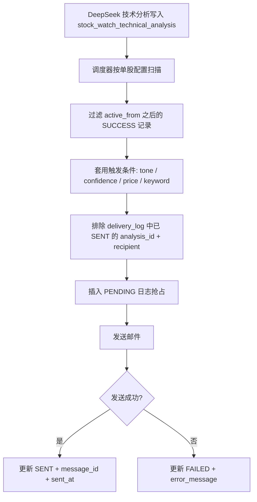

# 股票详情页单股配置中心技术方案

## 目标

把股票盯盘里的配置从分散入口收敛到单只股票详情页，按股票粒度配置：

- 行情抓取配置：东方财富抓取间隔、交易时段、失败重试、字段校验。
- LLM 分析配置：DeepSeek 网页 provider、分析频率、单股独立会话、上下文轮换。
- 邮件推送配置：收件邮箱必填、发送频率、测试邮件；发件 SMTP 先复用系统配置。
- 触发条件配置：哪些分析结论需要发送、哪些只记录不打扰。

关键约束：每次发送邮件时，只发送该股票此前没有成功发送过的分析结论，服务重启、调度器重试、手动触发都不能重复发送成功记录。

## 页面落点

建议落在 `frontend/src/views/StockWatch.vue` 的详情模式中，而不是全局设置页。

原因：

- 用户实际关心的是单只股票的盯盘策略，不同股票的通知对象、节奏、触发条件可能不同。
- 当前实时技术面分析模块已经在股票详情页，配置和结果放在同一上下文里更容易排查。
- 全局设置只适合作为默认值，例如默认 SMTP、默认抓取间隔、默认 DeepSeek bridge。

页面结构建议：

- 详情页顶部仍展示股票、行情、DeepSeek 会话状态。
- 新增“单股配置中心”区域，使用四个配置 Tab：行情抓取、LLM 分析、邮件推送、触发条件。
- 邮件推送 Tab 内展示“本次预计发送的未发送结论”预览，避免用户保存后不知道会发什么。
- 右侧保留发送闸门摘要：邮箱是否填写、SMTP 是否可用、触发条件是否启用、去重策略是否生效。

## 数据模型

### 1. 单股配置表

`stock_watch_delivery_config`

```sql
CREATE TABLE stock_watch_delivery_config (
    id BIGINT PRIMARY KEY AUTO_INCREMENT,
    symbol VARCHAR(32) NOT NULL,
    market VARCHAR(16) NOT NULL,
    enabled TINYINT NOT NULL DEFAULT 0,
    recipients_json TEXT NOT NULL,
    sender_mode VARCHAR(32) NOT NULL DEFAULT 'SYSTEM',
    frequency_type VARCHAR(32) NOT NULL DEFAULT 'MANUAL',
    interval_minutes INT NOT NULL DEFAULT 120,
    trigger_policy_json TEXT NULL,
    active_from DATETIME NOT NULL,
    last_dispatch_status VARCHAR(32) NULL,
    last_dispatch_message TEXT NULL,
    last_dispatch_at DATETIME NULL,
    gmt_create DATETIME NOT NULL DEFAULT CURRENT_TIMESTAMP,
    gmt_modified DATETIME NOT NULL DEFAULT CURRENT_TIMESTAMP ON UPDATE CURRENT_TIMESTAMP,
    UNIQUE KEY uk_sw_delivery_symbol (symbol, market)
);
```

字段说明：

- `recipients_json` 必填，保存多个收件邮箱。保存前必须校验至少一个合法邮箱。
- `sender_mode` 当前固定为 `SYSTEM`，表示复用系统 SMTP；单股差异体现在收件人、频率、触发条件和发送日志。
- `frequency_type` 支持 `IMMEDIATE` / `INTERVAL` / `DAILY_CLOSE` / `MANUAL`。
- `interval_minutes` 仅在 `INTERVAL` 下生效。每隔 2 小时发送一次就是 `frequency_type=INTERVAL`、`interval_minutes=120`。
- `trigger_policy_json` 存触发策略，避免后续新增条件时频繁改表。
- `active_from` 默认保存配置时间，避免第一次启用后补发大量历史结论。

### 2. 发送日志表

`stock_watch_delivery_log`

```sql
CREATE TABLE stock_watch_delivery_log (
    id BIGINT PRIMARY KEY AUTO_INCREMENT,
    config_id BIGINT NOT NULL,
    analysis_id BIGINT NOT NULL,
    symbol VARCHAR(32) NOT NULL,
    market VARCHAR(16) NOT NULL,
    recipient_hash VARCHAR(64) NOT NULL,
    recipient_masked VARCHAR(255) NOT NULL,
    status VARCHAR(32) NOT NULL,
    message_id VARCHAR(255) NULL,
    error_message TEXT NULL,
    sent_at DATETIME NULL,
    gmt_create DATETIME NOT NULL DEFAULT CURRENT_TIMESTAMP,
    gmt_modified DATETIME NOT NULL DEFAULT CURRENT_TIMESTAMP ON UPDATE CURRENT_TIMESTAMP,
    UNIQUE KEY uk_sw_delivery_once (analysis_id, recipient_hash),
    KEY idx_sw_delivery_config_status (config_id, status),
    KEY idx_sw_delivery_symbol_time (symbol, market, gmt_create)
);
```

去重原则：

- 判断是否发送过不能只靠时间 cursor，因为补发、重试、修改收件人都会让时间 cursor 变复杂。
- 使用 `analysis_id + recipient_hash` 唯一约束，保证同一条分析结论对同一个收件人只成功发送一次。
- 发送前先尝试插入 `PENDING` 日志抢占记录；插入失败说明其他调度或手动发送已抢占，直接跳过。
- 发送成功更新为 `SENT`，失败更新为 `FAILED`，失败记录可按策略重试。

## 后端接口

### 配置接口

- `GET /api/stock-watch/{market}/{symbol}/delivery-config`
- `PUT /api/stock-watch/{market}/{symbol}/delivery-config`
- `POST /api/stock-watch/{market}/{symbol}/delivery-config/test-email`
- `POST /api/stock-watch/{market}/{symbol}/delivery-config/dispatch-now`
- `GET /api/stock-watch/{market}/{symbol}/delivery-config/preview`

`preview` 返回当前配置下会被发送但尚未发送的分析结论列表，用于 UI 预览。

### 服务拆分

- `StockWatchDeliveryConfigService`：配置增删改查、邮箱校验、配置脱敏展示。
- `StockWatchDeliveryPlanner`：根据配置、频率、触发条件筛选应发送的分析记录。
- `StockWatchDeliveryService`：执行抢占日志、组装邮件、调用发送器、更新日志。
- `StockWatchDeliveryScheduler`：定时扫描启用配置，按频率触发发送。
- `NotificationService`：保留现有全局发送能力，但增加“按配置构造 JavaMailSender”的路径。

## 发送流程



## 邮件内容

邮件标题建议：

`[股票盯盘] 迈瑞医疗 300760 新增 2 条技术面结论`

正文结构：

- 股票、市场、当前价格、分析时间。
- 本次新增结论列表，每条包含 stance、tone、confidence、summary、evidence、DeepSeek 原会话链接。
- 触发原因：例如 `new_analysis + warning + confidence>=0.65`。
- 去重说明：本邮件只包含未发送过的分析结论。

## 触发条件通用表达

`trigger_policy_json` 示例：

```json
{
  "sendOnNewAnalysis": true,
  "tones": ["opportunity", "warning", "risk"],
  "minConfidence": 0.65,
  "keywords": ["突破", "跌破", "支撑失守", "放量"],
  "priceRules": [
    { "field": "latestPrice", "op": "<=", "value": 155 },
    { "field": "latestPrice", "op": ">=", "value": 170 }
  ],
  "includeManualRuns": true,
  "includeScheduledRuns": true
}
```

不要把股票行业、个股名称、迈瑞医疗这类内容硬编码到触发器里。触发器只认识通用字段：价格、结论类型、置信度、关键词、运行来源、规则命中。

## 频率语义

- `IMMEDIATE`：分析结论写入成功后尽快发送，仍然经过去重日志。
- `INTERVAL`：按 `interval_minutes` 聚合未发送结论，支持 30 分钟、2 小时、4 小时或任意 5-1440 分钟间隔。
- `DAILY_CLOSE`：每日收盘后汇总当天未发送结论。
- `MANUAL`：不自动发送，只在用户点击“立即发送未发送结论”时发送。

建议默认 `MANUAL` 或 `INTERVAL(120)`，不要默认立即发送，避免初期调试误打扰。

## 历史结论边界

建议默认不补发启用前的历史结论。

原因：

- 用户第一次配置邮箱时，可能已经有很多历史分析记录。
- 如果直接按“未发送”全量扫描，第一次保存可能发送几十封或一封超长汇总邮件。

可选功能：

- UI 提供“补发最近 1 / 3 / 7 / 30 天未发送结论”按钮。
- 补发仍然使用同一套 `analysis_id + recipient_hash` 去重日志。

## 安全与隐私

- 邮箱地址在日志中展示脱敏值，完整邮箱只保存在配置表。
- 当前版本不保存自定义 SMTP 密码；发件链路复用系统 SMTP 配置。
- 测试邮件和真实发送都必须明确区分，测试邮件不写入分析结论发送日志。
- UI 中不要展示 SMTP 密码回显。

## 实施顺序

1. 新增数据库表和 Mapper：配置表、发送日志表。
2. 新增后端配置 API 和 preview API，先不接调度器。
3. 前端把四个配置区合并到股票详情页，先实现保存、读取、测试邮件、预览。
4. 接入 `StockWatchDeliveryScheduler`，支持 `MANUAL` 和 `INTERVAL`。
5. 接入 `IMMEDIATE` 和 `DAILY_CLOSE`，再补失败重试策略。
6. 做一次端到端验证：新增分析结论 -> preview 可见 -> 手动发送 -> 日志 SENT -> 再次发送不重复。

## 验收标准

- 未填写邮箱时不能保存启用邮件推送。
- 测试邮件可独立发送，不污染真实发送日志。
- 同一条分析结论对同一个邮箱重复触发多次，只发送一次。
- 服务重启后，已发送结论不会重复发送。
- 修改收件人后，新收件人可以收到此前未对其发送过的结论，旧收件人不会重复收到。
- 四类配置都能在单只股票详情页查看和修改。
