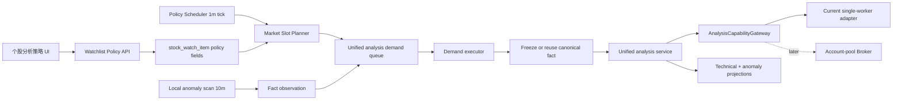
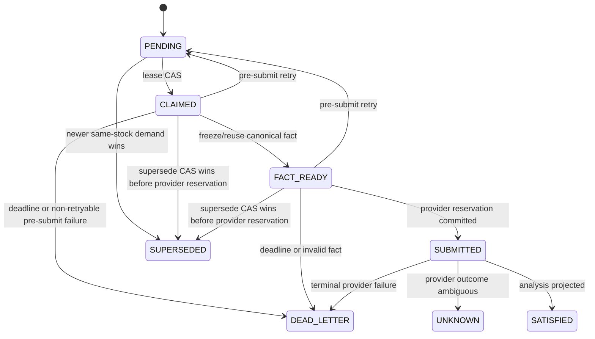

# 股票盯盘个股分析频率改造技术方案 v18

日期：2026-07-22  
状态：实施契约 v1 已通过方向审查，待编码验证  
范围：个股自动分析频率、异动升级策略、统一需求队列，以及未来账号池兼容边界  
不包含：本轮不改业务代码、不启用多账号并发、不改变邮件投递频率语义

## 1. 目标契约 v0

### 1.1 权威来源

- 用户要求每只股票可以配置不同的分析频率。
- 低关注股票需要支持“每天收盘后分析一次”。
- 自定义间隔必须能覆盖未来 10 分钟级别。
- 技术分析与异动解释尽量由一次 DeepSeek 统一分析完成。
- 未来底层会演进为账号池；上层不得感知账号、池、Worker 或调试端口。

### 1.2 必须满足

1. 明确区分行情扫描、DeepSeek 分析执行和邮件投递三个 cadence。
2. 每股至少支持 `INTERVAL`、`DAILY_CLOSE`、`ON_ANOMALY`、`PAUSED` 四种自动分析模式。
3. `INTERVAL` 支持 10～1440 分钟自定义值，且调度不因模型执行时长发生漂移。
4. 同一股票、周期和 canonical slot 不得重复提交不可逆模型请求。
5. 异动任务可以抢占普通定时任务，但已经提交后的请求不得被替换或盲目重试。
6. 设计必须兼容 `stock.unified-analysis.v1` 能力网关及未来账号池，不把物理路由字段上浮到业务层。
7. 现有股票升级后默认行为不突变；“归档分组”不能再被误当成“暂停分析”。
8. 周/月复盘是否额外调用模型必须显式配置，不能暗中突破“每天只分析一次”的用户预期。
9. 方案必须给出数据模型、状态机、调度算法、API、UI、迁移、回滚、测试和验收标准。

### 1.3 约束与非目标

- 当前生产 Bridge 仍是单 Worker，10 分钟是可配置能力，不是当前所有股票都能准时完成的吞吐承诺。
- 本地确定性异动扫描保持轻量；降低 DeepSeek 频率不等于必须降低行情扫描频率。
- 邮件的 `IMMEDIATE/INTERVAL/DAILY_CLOSE/MANUAL` 继续只控制投递，不复用为分析策略。
- 本期只为账号池预留能力网关；完整 Broker、账号健康与多 Worker 并发另行实施。
- 手工点击“立即分析”默认仍允许，即使股票处于 `PAUSED`；`PAUSED` 的含义是暂停自动分析。

## 2. 当前实现与缺口

### 2.1 当前行为

| 领域 | 当前实现 | 证据 |
| --- | --- | --- |
| 技术分析调度 | 全局 `fixedDelay=30m`，遍历全部 `scheduledRefs()` | `StockWatchTechnicalAnalysisService.java:188,363,3624` |
| 日内槽位 | SH/SZ/BJ 与 HK 都是固定 30 分钟槽位 | `StockWatchTechnicalAnalysisService.java:69-94` |
| 监控扫描 | 全局 10 分钟，规则与行情扫描共用 | `StockWatchMonitorService.java:140-168` |
| 个股配置 | `StockWatchItem` 只有股票、启用、来源和分组 | `StockWatchItem.java:8-18` |
| 邮件频率 | 单股支持投递频率，但不改变分析生成 | `StockWatchDeliveryService.java:335-352` |
| 异动分析需求 | 已有优先级、截止时间、租约和一次提交保护 | `StockWatchAnalysisDemandService.java:46-178` |
| 模型准入 | Java 单队列单线程，Node Bridge 全局 `inFlight` | `StockWatchBridgeAdmissionService.java:23-31`、`deepseek-web-bridge.js:21-33` |
| 账号隔离 | `accountKey` 已能隔离 Profile、端口、会话文件 | `deepseek-web-client.js:125-157` |

### 2.2 关键缺口

1. `group_key=archived` 仍可能 `enabled=true` 并进入定时分析。
2. 当前调度循环直接执行模型调用；第一只股票慢，会推迟后续股票。
3. `fixedDelay` 会以批次完成时间为下一轮起点，无法形成稳定的每股 10/30/60 分钟槽位。
4. 当前 `stock_watch_analysis_demand` 只接受带目标 fact 的异动需求，不能承接普通定时需求。
5. 周/月复盘仍是额外自动模型调用，没有跟个股“低频/暂停”策略统一。
6. 多账号 Profile 已隔离，但 Java 和 Node 仍全局串行，不能据此宣称账号池已经具备吞吐扩展能力。

## 3. 方案选择

### 3.1 候选 A：在旧循环中增加个股判断

做法：给 `StockWatchItem` 增加频率字段，在 `runScheduledBatch()` 中用 `if` 跳过未到期股票。

优点：改动最小。  
缺点：仍是单批次串行、`fixedDelay` 漂移、无积压治理、无未来账号池边界；10 分钟股票会被慢任务拖延。  
结论：不采用。它只能“少调用”，不能可靠实现个股 cadence。

### 3.2 候选 B：个股策略 + 稳定槽位规划器 + 统一需求队列 + 单账号网关

做法：配置保存在股票项；一分钟调度器只计算 due slot 并写入需求；执行器异步消费；模型调用经逻辑能力网关进入当前单账号 Bridge。

优点：满足当前目标，复用现有 demand/task 幂等基础，未来可替换为账号池 Broker。  
缺点：需要扩展 demand 状态机并迁移旧调度。  
结论：采用。它是本方案范围内找到的最佳路径，不宣称全局最优。

### 3.3 候选 C：先完成完整账号池再改 cadence

优点：一次性解决吞吐。  
缺点：扩大范围，真实双账号并发尚未验证，会推迟用户直接需要的个股配置。  
结论：不作为本期前置；只提前落能力网关。

## 4. 目标架构



职责边界：

- Scheduler 只决定“何时需要分析”，不直接等待 DeepSeek。
- Monitor 只负责轻量行情/规则检测和事实冻结，不因低频模型策略而停止全部行情扫描。
- Demand queue 负责幂等、优先级、截止时间、租约、合并和恢复。
- Unified analysis service 负责取数、Prompt、响应校验及投影。
- Capability gateway 负责逻辑能力到执行后端的转换；业务层不传 `accountKey`。

## 5. 个股策略模型

### 5.1 分析模式

| 模式 | 自动 DeepSeek 行为 | 本地异动扫描 | 典型用途 |
| --- | --- | --- | --- |
| `INTERVAL` | 按自定义槽位生成需求 | 保持 | 重点/普通监控 |
| `DAILY_CLOSE` | 每交易日收盘数据稳定后一次 | 保持 | 低关注股票 |
| `ON_ANOMALY` | 无普通定时需求，仅异动触发 | 保持 | 只关心异常变化 |
| `PAUSED` | 不创建任何自动模型需求 | 可继续刷新页面行情；不升级模型 | 暂时停止自动分析 |

`enabled=false` 表示股票不再进入后端自动体系；`PAUSED` 表示股票仍保留在列表、历史和 UI 中，但暂停自动模型分析。`group_key` 只负责展示分组，不能隐式改写策略。

### 5.2 异动升级策略

分析模式之外增加 `anomalyTriggerMode`：

| 值 | 行为 |
| --- | --- |
| `IMMEDIATE_ANALYSIS` | 异动 fact 立即创建 P0 统一分析需求 |
| `DEFER_TO_NEXT_SCHEDULE` | 保存异动 fact，合并到下一次定时/收盘分析 |
| `ALERT_ONLY` | 允许既有确定性通知，但不因此调用模型 |

约束：

- `ON_ANOMALY` 只能选择 `IMMEDIATE_ANALYSIS`。
- `PAUSED` 强制等效于 `ALERT_ONLY`，且不创建补充模型分析。
- `DAILY_CLOSE` 推荐默认 `DEFER_TO_NEXT_SCHEDULE`，避免低关注股票因普通异动重新变成高频模型调用。
- 邮件是否发送仍由规则、冷却和 delivery config 决定；此字段只控制是否升级为模型分析。

### 5.3 周/月复盘

新增：

- `weeklyReviewEnabled`
- `monthlyReviewEnabled`

规则：

- 两个字段只控制额外的 WEEK/MONTH 模型复盘。
- `PAUSED` 强制两者关闭。
- `ON_ANOMALY` 默认关闭。
- 从旧系统迁移时默认保留为开启，避免静默删除现有功能。
- UI 选择“每天收盘一次且不需要额外复盘”时，必须显式将两者关闭。

## 6. 稳定槽位算法

### 6.1 基本原则

1. Scheduler 每 60 秒运行一次，但只做数据库查询、槽位计算和幂等插入。
2. 槽位由市场开盘时间和策略计算，不以“上一次模型什么时候完成”为锚点，因此模型慢不会造成 cadence 漂移。
3. 同一扫描重复执行只会命中同一个 `demandKey`。
4. 服务重启后不补齐所有错过的中间槽位，只补当前有效的最新槽位，避免请求风暴。
5. 非交易日或数据不新鲜时，在模型提交前由 fact freshness gate 拦截。

### 6.2 市场时间

第一阶段支持现有市场：

- SH/SZ/BJ：09:30–11:30、13:00–15:00，收盘 15:00。
- HK：09:30–12:00、13:00–16:00，收盘 16:00。
- 时区统一为 `Asia/Shanghai`。

交易日判断不能只依赖周一到周五。Planner 可生成候选槽位，但 Executor 必须验证 quote/sourceTradeDate 与 freshness；节假日、停牌或陈旧行情不得调用 DeepSeek。

### 6.3 `INTERVAL`

- `intervalMinutes` 合法范围为 10～1440。
- 候选槽位以市场开盘 09:30 为固定锚点，按墙上时间递增；落在午休或闭市时段的候选槽位不执行。
- 例：A 股 30 分钟仍得到 09:30、10:00、…、11:30、13:00、…、15:00，兼容当前主要行为。
- 例：60 分钟得到 09:30、10:30、11:30、13:30、14:30。
- 大于单日交易时长的间隔每天最多产生一个开盘候选；如果用户要“每天收盘分析”，必须选择 `DAILY_CLOSE`，不要用 1440 分钟模拟。
- Scheduler 只在当前处于候选槽位的有效窗口时创建最新需求，不回放更早槽位。

规范标识：

```text
scheduleSlotKey = DAY:{tradeDate}:INTERVAL:{scheduledTime}
demandKey = sha256(v2|capability|market|symbol|scheduleSlotKey|businessGeneration)
```

### 6.4 `DAILY_CLOSE`

- 默认在市场收盘后 10 分钟进入 due 状态：A 股 15:10，港股 16:10。
- 同一 `tradeDate` 只生成一个需求。
- 必须满足 sourceTradeDate 为本交易日，且收盘数据 freshness gate 通过；否则延迟重试，超过当日 deadline 后记为 `SKIPPED_DATA_UNAVAILABLE`，不得拿上一交易日数据冒充本日收盘。
- 当日晚间重启可以补当天尚未执行的收盘需求；跨到下一交易日后不自动补发旧日模型请求。

规范标识：

```text
scheduleSlotKey = DAY:{tradeDate}:DAILY_CLOSE
```

### 6.5 `ON_ANOMALY` 与 `PAUSED`

- `ON_ANOMALY` 没有时间槽位；其 identity 使用已冻结的 `targetFactObservationKey`。
- `PAUSED` 不产生 scheduled/anomaly automatic demand；显式手工分析继续生成独立 `MANUAL` generation。

## 7. 数据模型

### 7.1 `stock_watch_item` 新增字段

```sql
analysis_mode              VARCHAR(32) NOT NULL DEFAULT 'INTERVAL'
analysis_interval_minutes  INT NULL DEFAULT 30
anomaly_trigger_mode       VARCHAR(32) NOT NULL DEFAULT 'IMMEDIATE_ANALYSIS'
weekly_review_enabled      TINYINT NOT NULL DEFAULT 1
monthly_review_enabled     TINYINT NOT NULL DEFAULT 1
analysis_policy_version    BIGINT NOT NULL DEFAULT 0
```

选择放在 `stock_watch_item` 而不是复用 delivery config 的原因：

- 一只股票当前只有一份统一分析策略，1:1 字段最简单。
- 邮件频率和分析频率是不同业务概念，复用会再次制造语义混淆。
- `analysis_policy_version` 可做乐观锁，避免图片/分组更新覆盖策略。

Mapper 必须拆分：

- `updateMetadata(...)`：只更新名称、图片、启用和分组。
- `updateAnalysisPolicy(..., expectedPolicyVersion)`：只更新策略，并 `policy_version+1`。

旧的通用 `update()` 不得同时无版本覆盖策略字段。

### 7.2 扩展 `stock_watch_analysis_demand`

新增字段：

```sql
capability                VARCHAR(64) NOT NULL DEFAULT 'stock.unified-analysis.v1'
trigger_type              VARCHAR(32) NOT NULL
schedule_slot_key         VARCHAR(96)
coalesce_key              VARCHAR(128) NOT NULL
source_policy_version     BIGINT
reason_codes_json         TEXT
trigger_context_json      TEXT
superseded_by_demand_id   BIGINT
```

`trigger_context_json` 只保存 canonical fact 引用、触发时间和规则编号等小型审计上下文，不复制行情原始大对象。它用于在不立即调用模型时，跨 Scheduler tick 保留待合并异动；具体 fact 仍以 observation/fact 表为事实源。

将以下 target fact 字段改为可空：

- `target_fact_observation_id`
- `target_fact_observation_key`
- `target_source_time_epoch_ms`
- `trade_date`

原因：异动需求创建时已经有冻结 fact；普通定时需求只知道业务槽位，需要在执行前采集并冻结 fact。进入 provider 提交阶段前，这些字段必须全部补齐。

新增索引：

```sql
INDEX idx_sw_analysis_demand_dispatch(status, not_before, priority, id)
INDEX idx_sw_analysis_demand_coalesce(symbol, market, capability, status, priority)
INDEX idx_sw_analysis_demand_slot(symbol, market, schedule_slot_key)
```

### 7.3 状态机



硬规则：

- 只有 `PENDING/CLAIMED/FACT_READY` 且确认尚未提交 provider 的任务可以重试或被替换。
- `SUBMITTED/UNKNOWN` 不得自动换账号或创建同 digest 的第二次提交。
- `providerSubmitCount` 仍是不可逆提交闸门，不能因账号池改造而下放到单个 Worker 私有状态。
- `markSuperseded(...)` 与 `reserveProviderSubmission(...)` 必须基于同一数据库行版本做互斥 CAS：supersede 先赢则执行器停止；reservation 先赢则旧需求进入 `SUBMITTED`，新异动只能成为后继需求。不能仅靠进程内标志消除该竞态。

## 8. 合并、优先级与截止时间

### 8.1 优先级

| 触发来源 | 优先级 |
| --- | ---: |
| `ANOMALY` | 400 |
| `MANUAL` | 300 |
| `DAILY_CLOSE` | 200 |
| `INTERVAL` | 100 |
| `WEEKLY/MONTHLY_REVIEW` | 80 |

优先级由后端根据 `triggerType` 派生，API 调用方不能任意填写。

### 8.2 latest-wins

- 同股票、同 capability 最多保留一条未提交的 DAY scheduled demand。
- 新 interval slot 到来时，旧的 `PENDING` interval demand 标记为 `SUPERSEDED`，保留审计记录。
- 异动到来时新建 P0 fact-bound demand，并 supersede 尚未提交的普通 scheduled demand。
- 如果旧任务已经 `SUBMITTED`，异动创建后继需求，不修改旧请求；两个结果都必须保留各自 observation provenance。
- `DEFER_TO_NEXT_SCHEDULE` 不创建可立即执行的模型需求；它创建或更新同股同 capability 的 `PENDING` demand，将 `not_before` 设置为 Planner 计算出的下一 scheduled due，并把 fact 引用写入 `trigger_context_json`。
- 下一 scheduled due 到来时，Scheduler 复用这条 demand、补齐 `schedule_slot_key` 和 scheduled reason，而不是再插入第二条需求；执行器冻结最新 canonical fact，同时把被合并的异动 fact 引用放进统一分析 Prompt 上下文。
- deferred upsert 使用 `coalesce_key + 未提交状态` 的数据库唯一约束或等价事务锁，不能用“先查再写”实现；重复 Monitor/Scheduler tick 只能更新同一条记录。
- 同一未到期 deferred demand 可合并多个 fact 引用，按 observation key 去重并设置数量上限；超过上限只保留首条、最新条和规则摘要，防止上下文无限增长。
- 如果策略在到期前切换为 `PAUSED/ALERT_ONLY`，该 deferred demand 标记为 `SUPERSEDED`；切换为 `IMMEDIATE_ANALYSIS` 不回放历史 deferred fact，只影响新异动。

### 8.3 截止时间

- INTERVAL：下一有效 interval slot 或本段闭市前，以较早者为准。
- DAILY_CLOSE：当日 23:00。
- ANOMALY：沿用当前 6 小时上限，但不得跨 source trade date 使用陈旧事实。
- MANUAL：由手工请求定义；同步 UI 可以继续等待已有超时边界，后续再改为 202/poll。

## 9. 逻辑能力网关

新增接口：

```java
public interface AnalysisCapabilityGateway {
    AnalysisCapabilityResult submit(AnalysisCapabilityRequest request);
}
```

业务请求只包含：

```text
capability = stock.unified-analysis.v1
sessionKey
submissionKey
requestDigest
priority
deadlineAt
symbol / market / periodType / observationKey
payload
```

禁止包含：

```text
accountKey / poolName / workerId / debugPort / profileRoot
```

第一阶段实现 `SingleWorkerAnalysisCapabilityGateway`：

- 内部继续使用当前 `StockWatchBridgeAdmissionService` 和 8791 Bridge。
- 适配器可把逻辑 `capability=stock.unified-analysis.v1` 映射为现有 `purpose=stock-analysis-v1`。
- 以后替换成 `AccountPoolAnalysisCapabilityGateway`，Scheduler、Demand 和技术分析业务代码不变。

## 10. 后端模块拆分

新增：

1. `StockWatchAnalysisPolicyService`
   - 校验/更新个股策略。
   - 计算推荐预设和容量提示。
2. `StockWatchMarketSessionPolicy`
   - 市场时段、收盘时间、槽位合法性。
3. `StockWatchAnalysisSchedulePlanner`
   - 纯函数：`policy + now + market -> DueDecision`。
4. `StockWatchAnalysisScheduler`
   - 每分钟扫描策略，幂等创建需求；不调用模型。
5. `AnalysisCapabilityGateway`
   - 模型能力边界。
6. `SingleWorkerAnalysisCapabilityGateway`
   - 当前 Bridge 适配器。

修改：

- `StockWatchListService`：返回/保存策略，metadata 与 policy 分开更新。
- `StockWatchAnalysisDemandService`：从 alert-only 扩为统一分析需求执行器。
- `StockWatchTechnicalAnalysisService`：保留取数、Prompt、解析和投影；新增 `runDemand()`，在 `POLICY` 模式下不再直接遍历股票执行 DAY 分析。
- `StockWatchMonitorService`：异动创建模型需求前读取个股策略；本地规则和通知门控保持独立。
- `StockWatchTechnicalAnalysisController`：提供策略状态和手工运行兼容入口。
- `StockWatchTechnicalSchemaInitializer`、`init.sql`、`schema-local.sql`、MyBatis XML 同步更新。

## 11. API 设计

### 11.1 查询

`GET /api/stock-watch/watchlist`

每只股票新增：

```json
{
  "analysisPolicy": {
    "mode": "INTERVAL",
    "intervalMinutes": 30,
    "anomalyTriggerMode": "IMMEDIATE_ANALYSIS",
    "weeklyReviewEnabled": true,
    "monthlyReviewEnabled": true,
    "version": 3
  },
  "analysisSchedule": {
    "nextDueAt": "2026-07-22T14:30:00+08:00",
    "lastDemandId": 123,
    "lastDemandStatus": "SATISFIED",
    "lastSuccessAt": "2026-07-22T14:02:31+08:00",
    "queuePosition": 0,
    "capacityStatus": "OK"
  }
}
```

### 11.2 更新策略

`PUT /api/stock-watch/watchlist/{market}/{symbol}/analysis-policy`

```json
{
  "mode": "DAILY_CLOSE",
  "intervalMinutes": null,
  "anomalyTriggerMode": "DEFER_TO_NEXT_SCHEDULE",
  "weeklyReviewEnabled": false,
  "monthlyReviewEnabled": false,
  "expectedVersion": 3
}
```

返回：

- `200`：新策略、version、nextDueAt、capacityAssessment。
- `400`：非法组合或间隔越界。
- `404`：股票不存在。
- `409`：策略版本冲突；前端刷新后重试。

兼容规则：现有 `POST /watchlist` 请求没有 `analysisPolicy` 时，不得重置策略。

### 11.3 调度状态

`GET /api/stock-watch/analysis-schedule/status?symbol=...&market=...`

返回 due decision、最近需求、积压、过期/跳过原因和容量估计。它是运行可观测性，不是完成 SLA。

## 12. UI 方案

在股票卡片和添加股票弹窗增加“分析频率”：

- 重点监控：30 分钟 + 异动立即分析。
- 普通监控：60 分钟。
- 低频监控：120 分钟。
- 每日收盘：收盘一次，异动并入收盘。
- 仅异动：异动后分析。
- 暂停自动分析。
- 自定义：10～1440 分钟。

高级项：

- 异动命中后：立即分析 / 并入下次 / 只提醒。
- 周复盘、月复盘开关。

卡片展示：

```text
分析策略：每日收盘
下次分析：今天 15:10
行情扫描：每 10 分钟（独立）
邮件发送：每日收盘（独立）
状态：等待 / 排队 / 分析中 / 容量延迟 / 暂停
```

普通 UI 不显示账号数量、账号池名称或 Worker。物理执行拓扑只进入未来管理页。

## 13. 容量与降级

当前 8791 `/health` 显示 `mode=single_worker`，因此配置 10 分钟不等于当前所有股票都能 10 分钟完成一次。

服务必须同时展示：

- `requestedCadence`：用户配置。
- `nextDueAt`：调度槽位。
- `estimatedStartAt/estimatedCompletionAt`：基于实际任务耗时与队列估计。
- `capacityStatus=OK/WARN/UNBOUNDED`。

保护策略：

1. scheduled demand latest-wins，过时 interval 不排成长队。
2. anomaly 保留高优先级。
3. 保存 10 分钟配置时只做容量预警，不静默改成 30 分钟。
4. 不用固定“最多几只股票”作为业务规则；账号池上线后容量会动态变化。
5. 估计必须基于真实完成耗时和健康 Worker 数；样本不足时显示不确定，不伪造 SLA。

## 14. 策略变更与并发语义

- 修改 30→10 分钟：不补历史槽位，从新策略的下一个合法槽位开始。
- 修改为 `PAUSED`：取消/标记 superseded 所有尚未 provider 提交的自动需求。
- 已经 `SUBMITTED/UNKNOWN` 的请求不能取消；UI 标记“策略已暂停，但本次已提交任务仍会完成”。
- 修改为 `DAILY_CLOSE`：旧 interval PENDING 失效，下一 due 为当日收盘或下个交易日。
- metadata 更新和 policy 更新使用不同 SQL；策略乐观锁冲突返回 409。
- 多 Scheduler 实例同时扫描时依赖唯一 `demandKey` 与数据库 CAS，不依赖 JVM `AtomicBoolean` 作为最终一致性保证。

## 15. 配置与灰度

```yaml
stock-watch:
  analysis-scheduler:
    mode: LEGACY # LEGACY / SHADOW / POLICY
    tick-interval-ms: 60000
    daily-close-delay-minutes: 10
    business-generation: 2
  analysis-capability:
    capability: stock.unified-analysis.v1
    provider-adapter: single-worker
```

阶段：

1. **Additive schema**：加字段、Mapper、API；所有旧股票迁移为 `INTERVAL/30`，保持旧 scheduler。
2. **Shadow planner**：新 Planner 只记录 due decision，不创建需求；与旧 30 分钟槽位对比。
3. **Demand generalization**：扩展 demand 状态机和 fact-ready 阶段，使用 fake gateway 集成测试。
4. **Canary policy mode**：按 allowlist 选择 1～2 只股票由新 scheduler 驱动；旧 scheduler 排除 canary，禁止双写模型请求。
5. **Policy mode**：全部 DAY 自动分析切换为新 scheduler；保留回退开关。
6. **Legacy cleanup**：稳定后删除旧 DAY 逐股直接执行分支；周/月改为独立 demand。

静态配置中的 `stock-watch.technical-analysis.symbols` 在迁移期只作为 watchlist bootstrap。进入 `POLICY` 模式后，真正的调度源必须是持久化股票策略，不能继续绕过数据库策略。

## 16. 回滚

- `POLICY -> LEGACY` 必须设置持久化 cutover fence，并等待新 scheduler 的 `PENDING/CLAIMED/FACT_READY/SUBMITTED/UNKNOWN` 全部收敛；只清空未提交需求不够，因为已提交任务可能与重新启用的 legacy slot 重复。
- 如果业务要求紧急回退，legacy scheduler 必须继续排除 fence 内的股票/槽位，直到原 generation 的提交结果成为 `SATISFIED/DEAD_LETTER`；`UNKNOWN` 不能靠超时后盲目放行。
- 回滚不删除策略字段、需求和审计记录。
- 已提交任务继续按原 task/ledger 收敛，不能因回滚重复提交。
- API/UI 可以继续显示已保存策略，但明确标记“当前由 legacy scheduler 执行”。

## 17. 测试方案

### 17.1 单元测试

`StockWatchAnalysisSchedulePlannerTest`：

1. SH/SZ/BJ/HK 开闭市、午休和周末。
2. 10/30/60/120/1440 分钟槽位。
3. DAILY_CLOSE 延迟、同日一次、晚间重启补偿。
4. PAUSED/ON_ANOMALY 不生成普通 due。
5. 策略变更不回放历史槽位。
6. quote trade date 陈旧时不形成 provider-ready 事实。

`StockWatchAnalysisPolicyServiceTest`：

- 合法组合、非法枚举、10～1440 边界。
- optimistic version 冲突。
- metadata 更新不覆盖策略。
- archived 分组不隐式暂停。

`StockWatchAnalysisDemandServiceTest`：

- 重复 tick 只创建一个 demand。
- newer scheduled supersede older pending。
- anomaly supersede 未提交 scheduled。
- submitted/unknown 不被替换。
- `markSuperseded` 与 `reserveProviderSubmission` 并发竞争时只有一个 CAS 成功。
- pre-submit 可重试，post-submit 不重试。
- deadline、lease recovery 和多实例 CAS。

### 17.2 集成测试

1. MySQL initializer、`init.sql` 和 H2 `schema-local.sql` 三份 schema 一致。
2. Policy API GET/PUT、400/404/409。
3. Scheduler→Demand→Fact→FakeGateway→Projection 完整链路。
4. DAY technical 与 anomaly 同时到达只有一次 provider submission。
5. DAILY_CLOSE 不受 delivery frequency 影响；delivery 也不反向改变分析策略。
6. legacy static symbols 在 POLICY 模式不能绕过持久化策略。
7. POLICY→LEGACY 回退时，cutover fence 阻止旧 scheduler 重复处理仍在收敛的 generation/slot。

### 17.3 架构约束测试

- Scheduler、Policy、Monitor 不得出现 `accountKey/debugPort/profileRoot`。
- 只有 `AnalysisCapabilityGateway` 实现可以访问 Bridge URL。
- `StockWatchTechnicalAnalysisService` 不再负责 DAY 股票列表遍历。
- `StockWatchDeliveryService` 不得作为分析 due 的事实来源。

### 17.4 真实冒烟

选择四只 canary：

1. A：INTERVAL 10。
2. B：DAILY_CLOSE。
3. C：ON_ANOMALY，注入真实可验证异动条件。
4. D：PAUSED。

验证：

- 数据库策略持久化与重启后保持。
- A 在槽位生成唯一需求；不承诺模型一定在 10 分钟内完成，但必须展示排队状态。
- B 盘中无模型需求，收盘 freshness 通过后仅一次。
- C 普通时段无定时模型需求，异动产生 P0。
- D 无自动需求，手工分析仍可显式执行。
- UI 展示、API 状态、任务/Bridge ledger、分析历史和邮件分别留证。

## 18. 验收标准

1. 四种模式及自定义分钟数都能持久化，并通过 API/UI 回读。
2. 重启、重复 tick、并发 Scheduler 不产生重复 demand 或重复 provider submission。
3. DAILY_CLOSE 盘中零调用，收盘且数据新鲜时每天一次。
4. ON_ANOMALY 只有真实本地异动 fact 才创建模型需求。
5. PAUSED 阻止所有自动模型需求，且不受 archived 分组语义影响。
6. 分析 cadence 和邮件 cadence 可独立配置和验证。
7. 周/月额外模型调用在 UI 中显式可见、可关闭。
8. 业务请求中不存在物理账号路由字段；当前单 Worker 与未来账号池可替换。
9. 容量不足时显示延迟/不确定，不静默降频、不伪造 SLA。
10. 单元、H2/MySQL 集成、真实数据、UI 和任务 ledger 证据齐全后才能宣称功能完成。

## 19. 预计文件边界

新增：

- `StockWatchAnalysisPolicyService.java`
- `StockWatchMarketSessionPolicy.java`
- `StockWatchAnalysisSchedulePlanner.java`
- `StockWatchAnalysisScheduler.java`
- `AnalysisCapabilityGateway.java`
- `SingleWorkerAnalysisCapabilityGateway.java`
- 对应 DTO 与测试类

修改：

- `StockWatchItem.java`
- `StockWatchItemMapper.java/xml`
- `StockWatchListService.java`
- `StockWatchListController.java`
- `StockWatchAnalysisDemand.java`
- `StockWatchAnalysisDemandMapper.java/xml`
- `StockWatchAnalysisDemandService.java`
- `StockWatchTechnicalAnalysisService.java`
- `StockWatchMonitorService.java`
- `StockWatchTechnicalSchemaInitializer.java`
- `init.sql`、`schema-local.sql`、`application.yml`
- `frontend/src/views/StockWatch.vue`

## 20. 仍需实现阶段确认的产品默认值

以下已有推荐值，但实现前可由用户最终确认：

1. DAILY_CLOSE 默认异动策略：推荐 `DEFER_TO_NEXT_SCHEDULE`。
2. 新增股票默认策略：推荐 `INTERVAL/30` 以延续当前行为。
3. 旧股票周/月复盘：迁移时保留开启；选择低频预设时推荐关闭。
4. `PAUSED` 是否允许手工分析：本方案推荐允许，并在 UI 明确为“暂停自动分析”。

## 21. `conclusion-auditor` 审核记录

### 21.1 路由与边界

- mode：`strict`（自动路由：验收条件含推导项，且涉及调度、监控、Bridge、未来账号池多个系统）。
- 执行方式：`非独立自审`；用户未显式要求另一位 reviewer、反证官或上下文隔离子 agent，因此没有把同模型自审伪装成独立证据。
- 审核轮次：2 轮。第一轮审目标、证据和缺失边界；修订后重跑被影响的 claim/conclusion gate 和确定性 packet gate。
- 搜索边界：当前代码、schema/Mapper、现有设计文档与本地 8791 health；未做实现、容量压测或真实双账号并发验证。

### 21.2 审核发现与裁决

| Finding | 裁决 | 处理 |
| --- | --- | --- |
| 审核包初稿的部分源码路径使用了错误模块前缀 | 属实 | 改为当前工作树 `src/main/...` 与 `scripts/...` 的精确指针后重新校验 |
| `DEFER_TO_NEXT_SCHEDULE` 只有概念，没有跨 tick 的持久化与多 fact 合并规则 | 属实 | 增加 `trigger_context_json`、future `not_before` demand、原子 upsert、去重与上限 |
| anomaly 抢占与 provider reservation 在 `CLAIMED/FACT_READY` 存在竞态 | 属实 | 规定两者必须在同一 DB row/version 上互斥 CAS，并新增并发测试 |
| POLICY→LEGACY 只处理未提交需求会让已提交/未知任务重复 | 属实 | 增加持久化 cutover fence，要求所有非终态收敛或继续排除对应槽位 |
| 为兼容账号池，应现在把 `accountKey` 加入业务 demand | 不属实 | 当前正确边界是逻辑 capability；账号选择属于后续 Broker，不应污染业务契约 |
| 当前单 Worker 能否让所有 10 分钟策略准时完成 | 待补证 | 明确降级为“可配置但非完成 SLA”，实现后必须容量压测并展示排队估计 |
| 四项产品默认值是否完全符合最终偏好 | 待补证 | 保留为实现前确认项，不阻塞技术架构成立 |

### 21.3 审核结论

- claim verdict：`supported`，仅指“候选 B 是当前审过候选中的可实施设计基线”。
- goal verdict：`aligned`，仅针对本轮“详细技术方案并审核”的目标。
- optimization verdict：`no_better_alternative_found`；比较范围是旧循环加判断、本文队列化方案、先建完整账号池三条路径，不代表全局最优。
- 未降级的边界：当前系统仍未实现每股频率；十分钟完成 SLA、真实 UI/API 和多账号并发仍未证明。
- 确定性审核包：`docs/audits/stock-watch-per-stock-analysis-cadence-v18.audit.json`，必须通过 `auditctl.py validate` 才能交付。
- 建议独立复核：正式实施前，如果数据库状态机或账号池边界发生变化，再运行一次上下文隔离 Challenger；本次非独立自审不等价于独立证据。

## 22. 实施契约 v1（覆盖前文冲突项）

2026-07-22 用户要求“继续”后，目标从“只交付方案”升级为“实现、启动并做真实 API/UI 验证”。本节是 Challenge/Optimize 后的实施约束；与前文冲突时以本节为准。

### 22.1 新的完成谓词

1. 10～1440 分钟必须在本期真实可配置、持久化并参与 Planner，而不是只预留字段。
2. `DAILY_CLOSE` 的“一次”定义为同一市场交易日、同一 canonical close slot 最多一次 provider submission；成功结果可以因外部失败缺失，但不得盲目重提。
3. 需要完成编译、单元/集成测试、受影响服务重启、真实 Policy API、真实页面配置与任务状态观察。
4. 邮件发送不是本期修改目标；必须证明邮件关闭、手动或冷却时，异动分析策略仍独立生效，不要求本轮额外发送测试邮件。
5. 现有 dirty/untracked 文件按 `docs/audits/stock-watch-cadence-implementation-baseline-2026-07-22.md` 保护，禁止把既有 v17 内容冒充成本轮独立改动。

### 22.2 canonical 提交账本

- `stock_watch_analysis_demand` 只表达业务意图、优先级、冻结 fact 与 `analysis_task_id` 关联；不再维护第二套不可逆 provider 真相。
- `stock_watch_analysis_task` 是唯一 provider 提交账本；其 canonical identity 继续是 `market + symbol + periodType + observationKey`，submission key 继续由 canonical observation 唯一派生。
- scheduled observation：`DAY:{tradeDate}:{HH:mm}`；DAILY_CLOSE 使用市场收盘槽 `15:00/16:00`；WEEK/MONTH 保持现有 period run-slot 语义。异动 fact-bound observation 保持 `DAY:{sourceDate}:alert:{factObservationKey}`。
- 执行顺序：claim demand → 冻结/验证 fact → 重验策略版本与 scheduler ownership → claim/reuse canonical analysis task → 执行或恢复 task → 回写 demand 关联/终态。
- 任何崩溃恢复先查询 canonical task 与 Bridge ledger；已有 task reservation 的 demand 只能关联并 reconcile，不能创建第二个 digest 或自动换账号重提。
- 保留旧 `provider_submit_count` 列仅为兼容历史 schema/tests；新流程不把它当提交闸门，后续独立迁移再删除。

### 22.3 异动与邮件解耦

- 在 Monitor 已形成 triggered + canonical fact 后、进入 delivery config/收件人/频率/cooldown 门控之前，调用 `StockWatchAnomalyAnalysisCoordinator`。
- Coordinator 按个股 `anomalyTriggerMode` 创建 immediate、deferred 或零模型 demand，并返回 `demandId/decisionReason` 写入 event。
- `StockWatchAlertDeliveryService` 只接收已有 `analysisDemandId` 并建立邮件补充义务，不再拥有模型需求创建权。
- 邮件缺配置、禁用、无收件人、MANUAL、DAILY_CLOSE 未到或 cooldown 命中，均不能撤销已经按分析策略创建的 demand。
- `GENERAL_LEGACY` 是明确例外：它保留自己的一次 DeepSeek 条件判断，不再额外创建 unified demand；event/UI 必须标记 `legacySeparateModelPath=true`。结构化 `QUOTE_ANOMALY_V1/RISK_PATTERN_REQUIRED` 才进入统一分析主路径。

### 22.4 策略与调度竞态

- `analysis_policy_version` 是并发事实；`analysis_policy_modified_at` 只用于防止策略更新后回放更早 interval slot 和审计，不替代版本 CAS。
- scheduled demand 插入必须使用 `INSERT ... SELECT stock_watch_item` 或等价数据库谓词，要求 item 仍 enabled 且 version/mode 与读到的一致。
- provider task claim 前再次读取 item；版本、mode 或 enabled 不匹配时，只能 supersede 尚未存在 canonical task 的 demand。
- 策略更新用乐观锁递增 version，并原子 supersede 旧版本所有未绑定 task 的 active demand。
- `active_coalesce_key` 为 nullable unique：只在 `PENDING/CLAIMED/FACT_READY/WAITING_TASK` 持有；绑定 canonical task、进入终态或 superseded 时清空。多实例不能使用“先查再写”代替唯一约束。

### 22.5 新旧 scheduler ownership

- 新增持久化 singleton ownership：`LEGACY/SHADOW/POLICY + generation + rowVersion`，旧、新 scheduler 每轮都读取。
- 部署顺序：先部署 fence-aware 二进制且保持 `LEGACY` → schema readiness 通过 → 显式切 `POLICY` → 新 scheduler 接管。禁止依赖不同实例本地配置完成滚动切换。
- canonical task claim 前再次校验 ownership；ownership 已变化则当前 demand 不进入 provider。
- 回退先切 ownership 阻止新 demand，再等待/关联所有已有 canonical task 收敛；`UNKNOWN` 不盲目放行。

### 22.6 DAILY_CLOSE close-ready

- eligible window 明确为对应市场 `[close+10m, 23:00]`；当日晚间重启可以补同一 close slot，跨自然日不补。
- 模型前必须同时满足：显式 sourceTradeDate 等于 demand tradeDate；quote timestamp 属于该交易日且不早于收盘前 5 分钟；最新日 K 日期等于该交易日；quote、日 K 与 demand 市场一致。
- 禁止用系统日期 fallback 证明 close-ready。节假日、停牌、陈旧同日行情会保持 pre-submit retry，超过 23:00 进入 `SKIPPED_DATA_UNAVAILABLE`，不调用模型。
- 第一阶段没有权威交易所半日市日历；遇到半日市只能安全延迟/跳过，不能伪造完整收盘。这是 live 边界，不影响普通交易日验收。

### 22.7 版本化 schema gate

- 不能依赖 `CREATE TABLE IF NOT EXISTS` 改变现有列。MySQL 必须显式 `ALTER TABLE ... MODIFY target_fact_* NULL`，并新增 policy、coalesce、trigger 与 ownership 字段/表；H2 schema 同步。
- 启用 `POLICY` 前用 JDBC metadata/information schema 验证必要列存在、target fact 可空、unique active coalesce 和 ownership singleton 可用；失败时保持 `LEGACY` 并返回可观察错误。

### 22.8 审查裁决

| Finding | 裁决 | 实施动作 |
| --- | --- | --- |
| 旧 audit 只证明设计，不能证明继续实施 | 属实 | 新建 implementation audit；实现前只能 partial，live 后才可升级 |
| dirty/untracked 重叠会夹带既有改动 | 属实 | 已冻结逐文件状态与哈希；只做增量补丁 |
| demand 被邮件门控 | 属实 | Coordinator 前移，Delivery 只消费 demandId |
| demand/task 双提交账本 | 属实 | canonical `analysis_task` 唯一，demand counter 降为兼容字段 |
| 正向切换与策略更新竞态 | 属实 | durable ownership + versioned insert + 执行前双检 |
| DAILY_CLOSE freshness 不可执行 | 属实 | 落字段级 close-ready 与补偿窗 |
| 旧表 NOT NULL 不会自动放宽 | 属实 | 版本化 ALTER + schema readiness gate |
| active coalesce 仅为占位设计 | 属实 | nullable unique key + 明确持有/清空状态 |
| GENERAL_LEGACY 破坏“一次统一”绝对结论 | 属实 | 降级为显式例外；结构化规则走统一主路径 |
| 可先做完整账号池 | 不属实 | 本期只保留 capability gateway，不实现池、账号健康和物理路由 |

方向审查结果：Challenge 对原实施入口为 `不通过`；上述修订完成后采用 Optimize 的 `B-core/material_improvement`，不继承第 21 节只针对设计工件的 aligned 结论。
